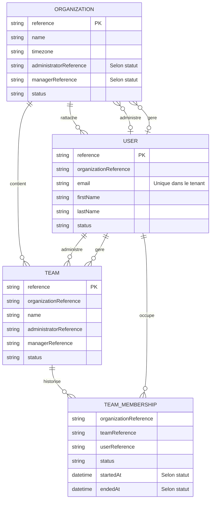

# TeamPulse — Common Data Model

[Ontologie métier](ontology.md) · [Graphe de connaissances](knowledge_graph.md)

## Périmètre et conventions

Ce modèle décrit le contenu du checkout `W001-T05-platform-http`, à partir de `3d59c861` et des modifications locales présentes lors de l'analyse. L'administration des organisations, des utilisateurs, des équipes et de leurs appartenances compose le socle implémenté. Le scénario produit couvre aussi les campagnes, réponses, résultats, actions et votes. Leur structure canonique reste **UNKNOWN** dans ce checkout. [SCENARIO-METIER-TEAMPULSE.md:95](../../docs/besoins/SCENARIO-METIER-TEAMPULSE.md#L95) · [ROADMAP.md:35](../../ROADMAP.md#L35)

| ID de domaine | Domaine | Sous-domaines et propriété |
| --- | --- | --- |
| [`domain:organization`](ontology.md#domain-organization) | Organisation | Cycle de vie et affectation de responsables, portés par `tp-organization`. |
| [`domain:identity`](ontology.md#domain-identity) | Identité | Création, invitation, cycle de vie et disponibilité d'un utilisateur d'organisation, portés par `tp-identity`. |
| [`domain:team`](ontology.md#domain-team) | Équipe | Création, cycle de vie, responsabilités et appartenance temporelle, portés par `tp-team`. |
| [`domain:administration`](ontology.md#domain-administration) | Administration de plateforme | Provisionnement d'utilisateur et garde de responsabilités, orchestrés par `tp-administration`. |

Le découpage en quatre domaines est **INFERRED** à partir des responsabilités explicites des modules et du scénario. L'administration orchestre les entités détenues par les autres domaines. [pom.xml:20](../../pom.xml#L20) · [ADR-W001-T05-api-metiers-et-administration-plateforme.md:37](../../docs/adr/W001/ADR-W001-T05-api-metiers-et-administration-plateforme.md#L37) · [ADR-W001-T05-api-metiers-et-administration-plateforme.md:60](../../docs/adr/W001/ADR-W001-T05-api-metiers-et-administration-plateforme.md#L60)

- Les IDs `entity:*` identifient les **types canoniques** dans les trois livrables. Les types d'attributs décrivent des valeurs métier et les noms suivent les contrats Java en `lowerCamelCase`. Les états conservent leur littéral source.
- `1` signifie obligatoire et `0..1` facultatif. Un lien par référence indique le type et le sens de la donnée. La garantie d'existence dépend du point d'entrée et de la persistance. L'ontologie précise ces garanties pour chaque prédicat.
- Une référence fonctionnelle est une chaîne de 26 caractères conforme à `PREFIX-YYYY-DDMM-XXXXXXXXXXXX`, avec préfixe majuscule sur trois lettres et suffixe de 12 caractères base 36 majuscules. La validation du format est syntaxique. Les familles observées sont `ORG`, `USR` et `TEM`. La fabrique produit des références monotones dans son instance. L'unicité inter-instances repose sur les contraintes par table en cas de collision. **CONFIRMED**. [ReferenceFormat.java:19](../../tp-common/src/main/java/io/teampulse/common/reference/ReferenceFormat.java#L19) · [MonotonicReferenceFactory.java:25](../../tp-common/src/main/java/io/teampulse/common/reference/MonotonicReferenceFactory.java#L25) · [ADR-TECH-006-functional-references-over-persistence-identifiers.md](../../docs/adr/technical/ADR-TECH-006-functional-references-over-persistence-identifiers.md)

## Entités canoniques

### `entity:organization` — Organisation

Racine métier des utilisateurs et équipes. Sa référence constitue la clé de partition utilisée par le tenant. Domaine `domain:organization`. **CONFIRMED**. [Organization.java:13](../../tp-organization/src/main/java/io/teampulse/organization/domain/organization/model/Organization.java#L13) · [TenantContext.java:12](../../tp-common/src/main/java/io/teampulse/common/context/TenantContext.java#L12)

| Attribut | Type | Cardinalité | Contrainte |
| --- | --- | --- | --- |
| `reference` | Référence `ORG` | 1 | Clé métier stable et unique. |
| `name` | Texte | 1 | Après `strip()`, non blanc et au plus 200 caractères selon la longueur Java. L'unicité du nom est **UNKNOWN** comme exigence métier. |
| `timezone` | Identifiant de fuseau | 1 | Valeur reconnue par `ZoneId.of`, espaces périphériques refusés. |
| `administratorReference` | Référence `USR` | 0..1 | Obligatoire en `ACTIVE` et `SUSPENDED`. |
| `managerReference` | Référence `USR` | 0..1 | Obligatoire en `ACTIVE`. Peut désigner la même personne que l'administrateur. |
| `status` | État d'organisation | 1 | `CREATING`, `ACTIVE`, `SUSPENDED`, `ARCHIVED`. |

**Relations.** Une organisation peut référencer zéro à plusieurs utilisateurs et équipes via leur tenant. Chaque rôle référence au plus un utilisateur du même tenant au moment de son affectation. Les utilisateurs et équipes pointent vers cette racine par une référence sans clé étrangère inter-module. L'existence de la ligne d'organisation est contrôlée par certains services. [OrganizationResponsibleUsersValidator.java:237](../../tp-organization/src/main/java/io/teampulse/organization/application/service/organization/OrganizationResponsibleUsersValidator.java#L237) · [V0.1.0__create_users.sql:8](../../tp-identity/src/main/resources/db/migration/identity/V0.1.0__create_users.sql#L8) · [V0.1.0__create_teams.sql:8](../../tp-team/src/main/resources/db/migration/team/V0.1.0__create_teams.sql#L8)

**Cycle de vie.** Création en `CREATING`, archivage terminal depuis tout autre état. Le domaine permet `CREATING → ACTIVE → SUSPENDED → ACTIVE`, suivant les contraintes structurelles sur les responsables. Le retrait du manager suspend une organisation active. L'activation et la réactivation sont différées dans le périmètre applicatif T05. [Organization.java:78](../../tp-organization/src/main/java/io/teampulse/organization/domain/organization/model/Organization.java#L78) · [Organization.java:344](../../tp-organization/src/main/java/io/teampulse/organization/domain/organization/model/Organization.java#L344) · [Organization.java:264](../../tp-organization/src/main/java/io/teampulse/organization/domain/organization/model/Organization.java#L264) · [Organization.java:471](../../tp-organization/src/main/java/io/teampulse/organization/domain/organization/model/Organization.java#L471) · [OrganizationStatus.java:15](../../tp-organization/src/main/java/io/teampulse/organization/domain/organization/model/OrganizationStatus.java#L15) · [ADR-W001-T05-api-metiers-et-administration-plateforme.md:37](../../docs/adr/W001/ADR-W001-T05-api-metiers-et-administration-plateforme.md#L37)

### `entity:user` — Utilisateur d'organisation

Identité métier rattachée à un tenant, susceptible d'occuper des responsabilités et de rejoindre plusieurs équipes. Domaine `domain:identity`. **CONFIRMED**. Les attributs ci-dessous sont des métadonnées de schéma. [User.java:13](../../tp-identity/src/main/java/io/teampulse/identity/domain/user/model/User.java#L13)

| Attribut | Type | Cardinalité | Contrainte |
| --- | --- | --- | --- |
| `reference` | Référence `USR` | 1 | Clé métier stable et unique globalement dans le stockage. |
| `organizationReference` | Référence `ORG` | 1 | Partition tenant, immuable dans le modèle. |
| `email` | Texte canonique | 1 | `strip()` puis minuscules `Locale.ROOT`, au plus 254 caractères Java. Une partie locale et un domaine non vides séparés par un unique `@`, sans espace. Clé alternative avec `organizationReference`. |
| `firstName`, `lastName` | Texte | 1 chacun | Après `strip()`, non blancs et au plus 100 caractères Java chacun. |
| `status` | État utilisateur | 1 | `INVITED`, `CREATING`, `ACTIVE`, `SUSPENDED`, `DEACTIVATED`. |

**Relations.** Un utilisateur porte une seule référence d'organisation. Il peut être titulaire de zéro à plusieurs responsabilités et disposer de zéro à plusieurs appartenances historiques, dans la même organisation lors des opérations qui vérifient son éligibilité. Le modèle accepte une référence tenant syntaxiquement valide et peut persister l'utilisateur sans organisation correspondante. [User.java:153](../../tp-identity/src/main/java/io/teampulse/identity/domain/user/model/User.java#L153) · [User.java:176](../../tp-identity/src/main/java/io/teampulse/identity/domain/user/model/User.java#L176) · [UserLifecycleService.java:40](../../tp-identity/src/main/java/io/teampulse/identity/application/service/user/UserLifecycleService.java#L40) · [V0.1.0__create_users.sql:24](../../tp-identity/src/main/resources/db/migration/identity/V0.1.0__create_users.sql#L24)

**Cycle de vie.** La création donne `CREATING`, l'invitation `INVITED`. Le domaine permet `INVITED → CREATING → ACTIVE → SUSPENDED → ACTIVE` et la désactivation depuis tous ces états, vers `DEACTIVATED` terminal. T05 expose création, invitation, liste et, via l'administration, suspension/désactivation. La disponibilité publique est dérivée par l'annuaire. [User.java:53](../../tp-identity/src/main/java/io/teampulse/identity/domain/user/model/User.java#L53) · [UserStatus.java:16](../../tp-identity/src/main/java/io/teampulse/identity/domain/user/model/UserStatus.java#L16) · [UserDirectoryService.java:44](../../tp-identity/src/main/java/io/teampulse/identity/application/service/user/UserDirectoryService.java#L44) · [UserLifecycle.java](../../tp-identity/src/main/java/io/teampulse/identity/api/lifecycle/UserLifecycle.java) · [UserController.java:54](../../tp-identity/src/main/java/io/teampulse/identity/infrastructure/web/user/UserController.java#L54) · [UserLifecycleAdministrationController.java:67](../../tp-administration/src/main/java/io/teampulse/administration/infrastructure/web/identity/UserLifecycleAdministrationController.java#L67)

### `entity:team` — Équipe

Unité d'une organisation réunissant deux responsabilités et des appartenances. Domaine `domain:team`. **CONFIRMED**. [Team.java:11](../../tp-team/src/main/java/io/teampulse/team/domain/team/model/Team.java#L11) · [TeamLifecycleService.java:32](../../tp-team/src/main/java/io/teampulse/team/application/service/team/TeamLifecycleService.java#L32)

| Attribut | Type | Cardinalité | Contrainte |
| --- | --- | --- | --- |
| `reference` | Référence `TEM` | 1 | Clé métier stable et unique. |
| `organizationReference` | Référence `ORG` | 1 | Organisation du tenant courant à la création, immuable dans le modèle. |
| `name` | Texte | 1 | Après `strip()`, non blanc, au plus 200 caractères Java. |
| `administratorReference`, `managerReference` | Référence `USR` | 1 chacun | Les deux rôles peuvent être occupés par le même utilisateur. |
| `status` | État d'équipe | 1 | `ACTIVE`, `SUSPENDED`, `ARCHIVED`. |

**Relations et cycle de vie.** Une équipe porte une référence d'organisation, deux références de responsables et peut avoir zéro à plusieurs appartenances. La création donne `ACTIVE`. Suspension et réactivation alternent entre `ACTIVE` et `SUSPENDED`. Les deux états permettent l'archivage, terminal. Création et réactivation contrôlent la disponibilité de l'organisation et des deux responsables. Les changements de responsables et les appartenances suivent des opérations indépendantes. [TeamStatus.java:14](../../tp-team/src/main/java/io/teampulse/team/domain/team/model/TeamStatus.java#L14) · [Team.java:138](../../tp-team/src/main/java/io/teampulse/team/domain/team/model/Team.java#L138) · [TeamLifecycleService.java:59](../../tp-team/src/main/java/io/teampulse/team/application/service/team/TeamLifecycleService.java#L59) · [TeamResponsibleUsersValidator.java:43](../../tp-team/src/main/java/io/teampulse/team/application/service/team/TeamResponsibleUsersValidator.java#L43) · [V0.1.0__create_teams.sql:8](../../tp-team/src/main/resources/db/migration/team/V0.1.0__create_teams.sql#L8) · [TeamResponsibilityDirectoryService.java:26](../../tp-team/src/main/java/io/teampulse/team/application/service/team/TeamResponsibilityDirectoryService.java#L26)

### `entity:team-membership` — Appartenance à une équipe

Occurrence temporelle reliant un utilisateur et une équipe dans le même tenant. `TeamMember` nomme cette occurrence dans le code. Domaine `domain:team`. **CONFIRMED** pour la structure et le cycle. [TeamMember.java:12](../../tp-team/src/main/java/io/teampulse/team/domain/team/model/TeamMember.java#L12) · [TeamMembershipService.java:37](../../tp-team/src/main/java/io/teampulse/team/application/service/teammember/TeamMembershipService.java#L37)

| Attribut | Type | Cardinalité | Contrainte |
| --- | --- | --- | --- |
| `organizationReference` | Référence `ORG` | 1 | Même partition que l'équipe. |
| `teamReference` | Référence `TEM` | 1 | Clé de l'équipe dans le CDM. Résolue depuis le chemin HTTP, puis représentée par `teamId` dans `TeamMember` et `team_id` en SQL. **INFERRED** pour la forme canonique. |
| `userReference` | Référence `USR` | 1 | Utilisateur contrôlé dans le même tenant au moment de l'ajout ou de l'invitation. |
| `status` | État d'appartenance | 1 | `INVITED`, `ACTIVE`, `SUSPENDED`, `REMOVED`. |
| `startedAt` | Instant | 0..1 | Absent en `INVITED`, présent en `ACTIVE` et `SUSPENDED`. En `REMOVED`, présent uniquement si la période a démarré dans les parcours observés. |
| `endedAt` | Instant | 0..1 | Présent en `REMOVED` seulement. Si `startedAt` existe, `endedAt ≥ startedAt`. |

**Identité et cardinalités.** Une appartenance désigne exactement une équipe et une référence utilisateur. Une paire équipe-utilisateur possède au plus une occurrence courante par tenant, pour un statut `INVITED`, `ACTIVE` ou `SUSPENDED`. Après retrait, une nouvelle occurrence est possible. Plusieurs historiques pour la même paire sont permis. Le triplet `(organizationReference, teamReference, userReference)` adresse l'occurrence courante. L'identifiant durable d'une occurrence historique est technique (`id` PostgreSQL). Sa clé métier et son identifiant public restent **UNKNOWN**. [TeamMembershipService.java:126](../../tp-team/src/main/java/io/teampulse/team/application/service/teammember/TeamMembershipService.java#L126) · [JpaTeamMemberRepositoryAdapterIT.java:67](../../tp-team/src/test/java/io/teampulse/team/infrastructure/persistence/repository/JpaTeamMemberRepositoryAdapterIT.java#L67) · [V0.1.1__create_team_members.sql:46](../../tp-team/src/main/resources/db/migration/team/V0.1.1__create_team_members.sql#L46)

**Cycle de vie.** Invitation en `INVITED` sans dates, ou ajout direct en `ACTIVE` avec date de début. L'activation d'une invitation initialise `startedAt`. La suspension et la réactivation conservent le début. Le retrait est possible depuis tout état courant et fixe `endedAt`, y compris pour une invitation jamais activée. `REMOVED` est terminal. [TeamMember.java:47](../../tp-team/src/main/java/io/teampulse/team/domain/team/model/TeamMember.java#L47) · [TeamMember.java:110](../../tp-team/src/main/java/io/teampulse/team/domain/team/model/TeamMember.java#L110) · [TeamMemberStatus.java:15](../../tp-team/src/main/java/io/teampulse/team/domain/team/model/TeamMemberStatus.java#L15) · [V0.1.1__create_team_members.sql:24](../../tp-team/src/main/resources/db/migration/team/V0.1.1__create_team_members.sql#L24)

## Correspondances techniques

### Persistance, projections et événements

| Entité | Persistance et colonnes métier | Contrats Java et HTTP | Événement |
| --- | --- | --- | --- |
| Organisation | `OrganizationEntity` et `OrganizationPersistenceMapper` ↔ `tp_organization.organizations` (`reference`, `name`, `timezone`, `admin_reference`, `manager_reference`, `status`). Le mapping convertit le fuseau entre `ZoneId` et chaîne. | `OrganizationProvisioningCommand` (nom, fuseau), `OrganizationLifecycleResult` (`organizationReference`) et `OrganizationResponse` (`reference`) portent la vue détaillée. `OrganizationResponsibilities` projette la référence, l'état et les deux responsables. | `OrganizationActivated` est annoncé pour W008. |
| Utilisateur | `UserEntity` et `UserPersistenceMapper` ↔ `tp_identity.users` (`reference`, `organization_reference`, `email`, `first_name`, `last_name`, `status`). | `UserProvisioningCommand` (email et noms), `UserLifecycleResult` (champ `userReference`), `UserResponse` (champ `reference`). Les vues courantes omettent `organizationReference`. `UserAvailability` est une projection de l'état. | `UserInvited(organizationReference, userReference)` après l'appel de persistance réussi. |
| Équipe | `TeamEntity` et `TeamPersistenceMapper` ↔ `tp_team.teams` (`reference`, `organization_reference`, `name`, `admin_reference`, `manager_reference`, `status`). | `CreateTeamRequest`/OpenAPI `CreateTeamInput` et `CreateTeamCommand` distinguent `administratorReference` et `adminReference`. `TeamResponse` omet le tenant et l'id. `TeamResponsibility` projette la référence et `TeamLifecycleState` selon le responsable recherché. | Aucun type d'événement Team relevé dans les sources analysées. |
| Appartenance | `TeamMemberEntity` et `TeamMemberPersistenceMapper` ↔ `tp_team.team_members` (`organization_reference`, `team_id`, `user_reference`, `status`, `started_at`, `ended_at`). FK `(team_id, organization_reference)` vers `teams`. | `TeamMemberRequest`/OpenAPI `TeamMemberInput` porte `userReference`. `TeamMemberCommand` ajoute `teamReference`. `TeamMemberResponse` expose l'utilisateur, l'état et les dates. | L'invitation d'appartenance persiste un état `INVITED`. Aucune publication associée relevée. |

Sources **CONFIRMED** pour les mappings et contrats déclarés. [OrganizationEntity.java:23](../../tp-organization/src/main/java/io/teampulse/organization/infrastructure/persistence/entity/OrganizationEntity.java#L23) · [OrganizationPersistenceMapper.java](../../tp-organization/src/main/java/io/teampulse/organization/infrastructure/persistence/mapper/OrganizationPersistenceMapper.java) · [OrganizationResponse.java:16](../../tp-organization/src/main/java/io/teampulse/organization/infrastructure/web/organization/OrganizationResponse.java#L16) · [OrganizationResponsibilities.java:13](../../tp-organization/src/main/java/io/teampulse/organization/api/organization/OrganizationResponsibilities.java#L13) · [UserEntity.java:24](../../tp-identity/src/main/java/io/teampulse/identity/infrastructure/persistence/entity/UserEntity.java#L24) · [UserPersistenceMapper.java](../../tp-identity/src/main/java/io/teampulse/identity/infrastructure/persistence/mapper/UserPersistenceMapper.java) · [UserResponse.java:8](../../tp-identity/src/main/java/io/teampulse/identity/infrastructure/web/user/UserResponse.java#L8) · [UserLifecycleResult.java:6](../../tp-identity/src/main/java/io/teampulse/identity/api/lifecycle/UserLifecycleResult.java#L6) · [UserInvited.java:8](../../tp-identity/src/main/java/io/teampulse/identity/events/UserInvited.java#L8) · [TeamEntity.java:23](../../tp-team/src/main/java/io/teampulse/team/infrastructure/persistence/entity/TeamEntity.java#L23) · [TeamPersistenceMapper.java](../../tp-team/src/main/java/io/teampulse/team/infrastructure/persistence/mapper/TeamPersistenceMapper.java) · [CreateTeamRequest.java:7](../../tp-team/src/main/java/io/teampulse/team/infrastructure/web/team/CreateTeamRequest.java#L7) · [TeamResponse.java:6](../../tp-team/src/main/java/io/teampulse/team/infrastructure/web/team/TeamResponse.java#L6) · [TeamResponsibility.java:6](../../tp-team/src/main/java/io/teampulse/team/api/TeamResponsibility.java#L6) · [TeamMemberEntity.java:25](../../tp-team/src/main/java/io/teampulse/team/infrastructure/persistence/entity/TeamMemberEntity.java#L25) · [TeamMemberPersistenceMapper.java](../../tp-team/src/main/java/io/teampulse/team/infrastructure/persistence/mapper/TeamMemberPersistenceMapper.java) · [TeamMemberResponse.java:8](../../tp-team/src/main/java/io/teampulse/team/infrastructure/web/teammember/TeamMemberResponse.java#L8) · [TeamMembershipService.java:49](../../tp-team/src/main/java/io/teampulse/team/application/service/teammember/TeamMembershipService.java#L49) · [ADR-W001-T05-api-metiers-et-administration-plateforme.md:109](../../docs/adr/W001/ADR-W001-T05-api-metiers-et-administration-plateforme.md#L110)

### Champs de support et divergences de représentation

| Sujet | Lecture et impact |
| --- | --- |
| Métadonnées de stockage | Les quatre tables stockent `id` séquencé, `version` pour le verrouillage optimiste, `created_at`/`modified_at` en `TIMESTAMPTZ` et `created_by`/`modified_by` en texte. `Team` transporte l'id interne nécessaire à la jointure du module. Le stockage métier reste réparti en trois schémas Flyway. **CONFIRMED**. [V0.1.0__create_users.sql:8](../../tp-identity/src/main/resources/db/migration/identity/V0.1.0__create_users.sql#L8) · [V0.1.0__create_organizations.sql:8](../../tp-organization/src/main/resources/db/migration/organization/V0.1.0__create_organizations.sql#L8) · [V0.1.0__create_teams.sql:8](../../tp-team/src/main/resources/db/migration/team/V0.1.0__create_teams.sql#L8) · [V0.1.1__create_team_members.sql:8](../../tp-team/src/main/resources/db/migration/team/V0.1.1__create_team_members.sql#L8) · [Team.java:18](../../tp-team/src/main/java/io/teampulse/team/domain/team/model/Team.java#L18) · [ADR-TECH-010-jpa-managed-technical-state-and-optimistic-locking.md](../../docs/adr/technical/ADR-TECH-010-jpa-managed-technical-state-and-optimistic-locking.md) |
| Contexte et acteur | `TenantContext.tenantReference` représente la partition de travail. La référence de l'acteur passe séparément dans `ActorContext` et alimente l'audit JPA. Au démarrage courant, le fournisseur par défaut représente l'acteur système. Le contexte local est stable dans un processus et dépourvu de lien garanti avec une organisation persistée. **CONFIRMED**. [TenantContext.java:12](../../tp-common/src/main/java/io/teampulse/common/context/TenantContext.java#L12) · [ActorContext.java:11](../../tp-common/src/main/java/io/teampulse/common/context/ActorContext.java#L11) · [JpaAuditingConfiguration.java:19](../../tp-app/src/main/java/io/teampulse/config/JpaAuditingConfiguration.java#L19) · [LocalTenantContextProvider.java:29](../../tp-app/src/main/java/io/teampulse/context/LocalTenantContextProvider.java#L29) |
| Résultat d'administration utilisateur | `UserLifecycleAdministrationResult` et `UserLifecycleAdministrationResponse` contiennent `organizationReference` et `userReference`. Ils rapprochent deux références dans le résultat des opérations de création et d'invitation initiales. Aucune table propre à l'administration n'est déclarée. **CONFIRMED**. [UserLifecycleAdministrationResult.java:6](../../tp-administration/src/main/java/io/teampulse/administration/application/port/in/identity/UserLifecycleAdministrationResult.java#L6) · [UserLifecycleAdministrationResponse.java:3](../../tp-administration/src/main/java/io/teampulse/administration/infrastructure/web/identity/UserLifecycleAdministrationResponse.java#L3) · [UserLifecycleAdministrationService.java:68](../../tp-administration/src/main/java/io/teampulse/administration/application/service/identity/UserLifecycleAdministrationService.java#L68) |
| Synonymes et noms de schémas | `adminReference` / `administratorReference` / `admin_reference` désignent la même référence. `ResponsibleUserInput` est le nom OpenAPI de DTO distincts de Team et Organization, avec la propriété `userReference` dans les deux exports consultés. L'alignement courant est local à ces snapshots. **CONFIRMED**. [AssignOrganizationResponsibleUserRequest.java:12](../../tp-organization/src/main/java/io/teampulse/organization/infrastructure/web/organization/AssignOrganizationResponsibleUserRequest.java#L12) · [TeamResponsibleUserRequest.java:7](../../tp-team/src/main/java/io/teampulse/team/infrastructure/web/team/TeamResponsibleUserRequest.java#L7) · `tp-organization/target/openapi.yaml:192` · `tp-team/target/openapi.yaml:287` |
| Statut et disponibilité | Les états sont des enums dans les modèles. Les contrats lifecycle utilisateurs et organisations les projettent en chaînes. L'équipe expose aussi un enum public pour le contrat de responsabilités. Les valeurs de disponibilité sont dérivées et utilisées comme résultats de lecture. **CONFIRMED**. [UserLifecycleResult.java:6](../../tp-identity/src/main/java/io/teampulse/identity/api/lifecycle/UserLifecycleResult.java#L6) · [OrganizationLifecycleResult.java:13](../../tp-organization/src/main/java/io/teampulse/organization/api/lifecycle/OrganizationLifecycleResult.java#L13) · [TeamLifecycleState.java](../../tp-team/src/main/java/io/teampulse/team/api/TeamLifecycleState.java) · [UserDirectoryService.java:44](../../tp-identity/src/main/java/io/teampulse/identity/application/service/user/UserDirectoryService.java#L44) · [OrganizationDirectoryService.java:81](../../tp-organization/src/main/java/io/teampulse/organization/application/service/organization/OrganizationDirectoryService.java#L81) |
| Métadonnées OpenAPI | Les quatre exports existants correspondent aux routes de succès relevées et déclarent `0.1.0-SNAPSHOT`. Les snapshots d'organisation et de plateforme omettent `required` sur les objets de réponse correspondants. La lecture de ces exports seule laisse donc les cardinalités de réponse sous-spécifiées. Les erreurs métiers sont documentées ici à partir des advices propriétaires. **CONFIRMED**. `tp-identity/target/openapi.yaml` · `tp-organization/target/openapi.yaml` · `tp-team/target/openapi.yaml` · `tp-administration/target/openapi.yaml` · [SharedHttpErrorAdvice.java](../../tp-web-support/src/main/java/io/teampulse/websupport/error/SharedHttpErrorAdvice.java) |
| Frontend | Les sources `slidev/` exposent le cours et la présentation produit. Aucun modèle ou flux de données d'un frontend métier n'a été identifié dans ce checkout. **UNKNOWN** pour les correspondances UI métier. [package.json](../../slidev/package.json) · [slides.md](../../slidev/slides.md) · [teampulse.md](../../slidev/pages/program/teampulse.md) |

Les quatre fichiers `target/openapi.yaml` sont des instantanés générés consultés pour leur valeur contractuelle. Les commandes, contrôleurs, DTO et POM accessibles depuis le [graphe](knowledge_graph.md#surfaces-http) servent de références durables. La synchronisation complète des exports avec le code courant reste **UNKNOWN**.

## Diagramme entité–relation

Les cardinalités côté organisation et utilisateur décrivent le modèle métier. Les liens entre modules reposent sur des références, avec validation applicative selon le parcours. La FK composite garantit la cohérence équipe-tenant de l'appartenance en base.

`PK` marque une clé métier dans le diagramme. Les conditions d'éligibilité et les transitions sont indexées dans le [registre des règles](ontology.md#regles).
