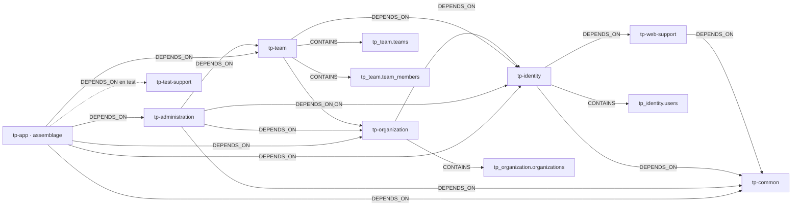
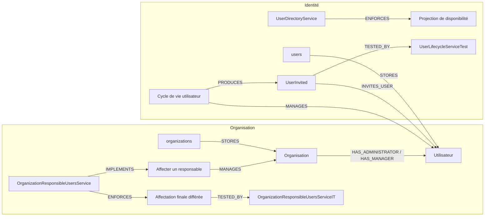
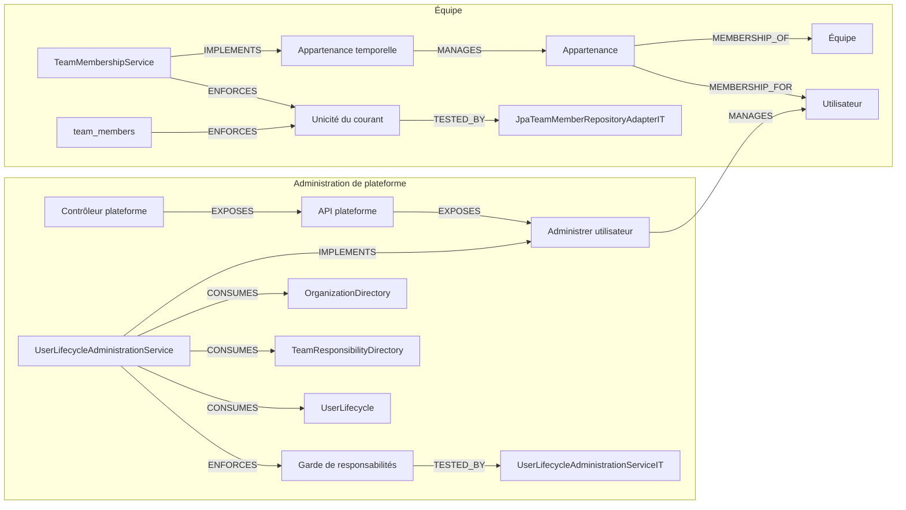

# TeamPulse — Graphe de connaissances

[Common Data Model](cdm.md) · [Ontologie métier](ontology.md) · [Catalogue d'ingestion](#catalogue-ingestion)

## Périmètre des preuves

Analyse du checkout local `W001-T05-platform-http`, HEAD `3d59c861`, avec les modifications locales au moment de la lecture. L'inventaire a parcouru le contenu de **395 fichiers**. Il comprend 189 sources Java principales, 93 fichiers de tests et de configuration de test, 109 autres fichiers texte versionnés ou en cours d'ajout, ainsi que les 4 exports OpenAPI locaux retenus pour leur valeur contractuelle. L'index de contenu a couvert l'ensemble de ce périmètre. La lecture détaillée a ciblé les sources qui déterminent les comportements, contraintes et divergences modélisés.

| Famille | Principales sources analysées |
| --- | --- |
| Architecture et assemblage | Reactor Maven à huit modules, Java 25, Spring Boot 4.1.0 et Spring Modulith 2.0.6. `tp-app` assemble les modules dans un monolithe. Les namespaces publics sont vérifiés par Modulith et les frontières internes par ArchUnit. [pom.xml:20](../../pom.xml#L20) · [pom.xml:32](../../pom.xml#L32) · [pom.xml](../../tp-app/pom.xml) · [ModulithArchitectureTests.java](../../tp-app/src/test/java/io/teampulse/architecture/ModulithArchitectureTests.java) · [BusinessModuleArchitectureRules.java](../../tp-app/src/test/java/io/teampulse/architecture/BusinessModuleArchitectureRules.java) |
| Données et tests | PostgreSQL partagé en trois schémas métier, quatre migrations métier, mapping et contrôles d'écriture. Tests de domaine, services transactionnels, JPA/Testcontainers et MockMvc sur les quatre modules propriétaires, dont l'orchestration réelle d'administration inter-modules. [IdentityFlywayConfiguration.java](../../tp-identity/src/main/java/io/teampulse/identity/config/IdentityFlywayConfiguration.java) · [OrganizationFlywayConfiguration.java](../../tp-organization/src/main/java/io/teampulse/organization/config/OrganizationFlywayConfiguration.java) · [TeamFlywayConfiguration.java](../../tp-team/src/main/java/io/teampulse/team/config/TeamFlywayConfiguration.java) · [AbstractMvcIT.java](../../tp-test-support/src/main/java/io/teampulse/testsupport/AbstractMvcIT.java) · [UserLifecycleAdministrationControllerIT.java:55](../../tp-administration/src/test/java/io/teampulse/administration/infrastructure/web/identity/UserLifecycleAdministrationControllerIT.java#L55) |
| Contrats et événements | Contrôleurs, annotations, DTO, quatre exports OpenAPI locaux et configuration Maven de génération. Contrats Java publics de lecture et d'écriture. `UserInvited` constitue le fait d'intégration observé. [pom.xml:177](../../tp-identity/pom.xml#L177) · [pom.xml:182](../../tp-organization/pom.xml#L182) · [pom.xml:186](../../tp-team/pom.xml#L186) · [pom.xml:167](../../tp-administration/pom.xml#L167) · [UserInvited.java:8](../../tp-identity/src/main/java/io/teampulse/identity/events/UserInvited.java#L8) |
| Besoins et décisions | Scénario produit, besoins et ADR W001, ADR techniques, README, roadmap, Slidev, configuration locale et CI. Le scénario est en Draft et contient des objectifs de versions futures. [SCENARIO-METIER-TEAMPULSE.md:3](../../docs/besoins/SCENARIO-METIER-TEAMPULSE.md#L3) · [ROADMAP.md:35](../../ROADMAP.md#L35) · [README.md](../../docs/besoins/W001/README.md) · [W001.md](../../slidev/pages/weeks/W001.md) · [ci.yml](../../.github/workflows/ci.yml) |

Les dépendances installées, ressources graphiques, fichiers binaires (dont le classeur de roadmap), outillage propre à l'agent, lockfile Slidev et sorties de compilation ont été écartés. Les quatre exports OpenAPI constituent l'exception pour la lecture des contrats. Les jeux de données de test ont été considérés pour leurs assertions, sans créer de nœud d'instance ni reprendre de valeurs individuelles. Aucun déploiement, base ou historique distant n'a été inspecté.

## Types du graphe

| Type | Signification |
| --- | --- |
| `Domain`, `Entity`, `Concept`, `Rule` | Domaine fonctionnel, type canonique du CDM, terme de l'ontologie ou règle. |
| `Process`, `UseCase`, `Event` | Parcours couvrant une ou plusieurs capacités, capacité d'un port, fait publié. |
| `Module`, `API`, `Component`, `Table` | Module Maven, interface HTTP/Java, rôle technique identifié dans le code, table SQL métier. |
| `Test`, `Document`, `Decision`, `Finding` | Source d'assertion, document d'intention, ADR et statut déclaré, contradiction ou lacune observée. |

Le type `Microservice` serait pertinent après une extraction réseau. Le reactor et l'assemblage observés décrivent des modules in-process. Une future ingestion peut accepter `Instance` avec `INSTANCE_OF` quand des instances autorisées et vérifiables existent. Le catalogue actuel porte sur des types et des preuves de conception. [ADR-TECH-001-maven-spring-modulith-modular-monolith.md](../../docs/adr/technical/ADR-TECH-001-maven-spring-modulith-modular-monolith.md) · [ROADMAP.md:58](../../ROADMAP.md#L58)

| Relation | Direction et sens |
| --- | --- |
| `BELONGS_TO`, `CONTAINS` | Élément → domaine propriétaire, contenant → artefact ou étape du périmètre. |
| `IMPLEMENTS`, `ENFORCES`, `APPLIES_TO` | Composant → capacité/contrat, composant/table → règle, règle → concept/entité. |
| `EXPOSES`, `CONSUMES`, `DEPENDS_ON` | Adaptateur/contrat → surface/capacité, consommateur → contrat public, artefact → dépendance. |
| `MANAGES`, `PERSISTS`, `STORES` | Capacité/composant → entité manipulée, composant → table écrite ou lue, table → type de données métier représenté. |
| `PRODUCES` | Parcours ou capacité → événement réellement publié par le code. |
| `DOCUMENTED_BY`, `ADOPTS`, `TESTED_BY`, `RELATES_TO` | Fait → document qui le décrit, ADR d'adoption → ADR technique, fait → test qui formule une assertion sur ce fait, constat → nœud concerné. |
| Prédicats de l'ontologie | Liens typés sur le modèle métier. Voir les [prédicats et cardinalités](ontology.md#predicats-metier). |

## Surfaces HTTP

Le tableau reprend les annotations serveur et les quatre exports locaux concordants sur les **28 opérations de succès**. `{org}`, `{team}` et `{user}` désignent respectivement `{organizationReference}`, `{teamReference}` et `{userReference}`.

| Nœud API | Base, opérations et statuts de succès | Preuve principale |
| --- | --- | --- |
| `api:identity-http` | `/api/users`. GET collection 200, POST collection et POST `/invitations` 201. | [UserController.java:24](../../tp-identity/src/main/java/io/teampulse/identity/infrastructure/web/user/UserController.java#L24) · [pom.xml:177](../../tp-identity/pom.xml#L177) |
| `api:organization-http` | `/api/organizations`. POST collection 201, GET `/{org}/responsibilities` 200. POST/PUT `/{org}/administrator` et `/{org}/manager` 200. DELETE `/{org}/manager` 204. POST `/{org}/suspension` et `/{org}/archive` 200. | [OrganizationController.java:27](../../tp-organization/src/main/java/io/teampulse/organization/infrastructure/web/organization/OrganizationController.java#L27) · [pom.xml:182](../../tp-organization/pom.xml#L182) |
| `api:team-http` | `/api/teams`. POST collection 201. POST `/{team}/suspension`, `/reactivation` et `/archive` (sous la même équipe) 200. PUT `/{team}/administrator` et `/{team}/manager` 200. POST `/{team}/members` et `/{team}/invitations` 201. POST `/{team}/members/{user}/activation`, `/suspension`, `/reactivation` et `/removal` sous le même membre 200. | [TeamController.java:22](../../tp-team/src/main/java/io/teampulse/team/infrastructure/web/team/TeamController.java#L22) · [TeamMemberController.java:20](../../tp-team/src/main/java/io/teampulse/team/infrastructure/web/teammember/TeamMemberController.java#L20) · [pom.xml:186](../../tp-team/pom.xml#L186) |
| `api:platform-http` | `/api/platform`. POST `/users` et `/users/invitations` 201. POST `/users/{user}/suspension` et `/users/{user}/deactivation` 204. Le contrôleur résout le tenant côté serveur ; l'authentification et l'autorisation sont différées à W008. | [UserLifecycleAdministrationController.java:27](../../tp-administration/src/main/java/io/teampulse/administration/infrastructure/web/identity/UserLifecycleAdministrationController.java#L27) · [pom.xml:167](../../tp-administration/pom.xml#L167) |

Les contrôleurs tenantés résolvent le tenant côté serveur. La surface d'organisation accepte dans son URI la ressource cible de l'opération de plateforme. Les advices de module distinguent notamment ressource absente (404), état/éligibilité en conflit (409), données métier invalides (422) et indisponibilité des annuaires selon la traduction du module. L'advice partagé couvre les erreurs structurelles du transport, avec `ApiError(code, message)`. Les exports consultés déclarent les succès uniquement. [OrganizationController.java:45](../../tp-organization/src/main/java/io/teampulse/organization/infrastructure/web/organization/OrganizationController.java#L45) · [ApiError.java:9](../../tp-common/src/main/java/io/teampulse/common/error/ApiError.java#L9) · [UserHttpErrorAdvice.java](../../tp-identity/src/main/java/io/teampulse/identity/infrastructure/web/user/UserHttpErrorAdvice.java) · [OrganizationHttpErrorAdvice.java](../../tp-organization/src/main/java/io/teampulse/organization/infrastructure/web/organization/OrganizationHttpErrorAdvice.java) · [TeamHttpErrorAdvice.java](../../tp-team/src/main/java/io/teampulse/team/infrastructure/web/TeamHttpErrorAdvice.java) · [PlatformAdministrationHttpErrorAdvice.java](../../tp-administration/src/main/java/io/teampulse/administration/infrastructure/web/PlatformAdministrationHttpErrorAdvice.java) · [SharedHttpErrorAdvice.java](../../tp-web-support/src/main/java/io/teampulse/websupport/error/SharedHttpErrorAdvice.java)

La configuration de `tp-app` désactive le descriptif OpenAPI par défaut et le réactive en local. Ce réglage porte sur le descriptif Springdoc. Les routes métier suivent les contrôleurs du tableau. [application.yaml:19](../../tp-app/src/main/resources/application.yaml#L19) · [application-local.yaml:8](../../tp-app/src/main/resources/application-local.yaml#L8)

## Graphe global

## Sous-graphes par domaine et liens d'implémentation

## Parcours de lecture

| Question | Traversée et réponse sourcée |
| --- | --- |
| Quel composant interdit de finaliser les responsables d'une organisation encore en création ? | `rule:org-activation-deferred ← ENFORCES — component:org-responsibles`. `rejectDeferredTransition` lève un refus avant mutation lorsque les deux responsables seraient disponibles. L'IT exerce aussi le cas suspendu. [OrganizationResponsibleUsersService.java:176](../../tp-organization/src/main/java/io/teampulse/organization/application/service/organization/OrganizationResponsibleUsersService.java#L176) · [OrganizationResponsibleUsersServiceIT.java:79](../../tp-organization/src/test/java/io/teampulse/organization/application/service/organization/OrganizationResponsibleUsersServiceIT.java#L79) |
| Quels services manipulent un utilisateur ? | Rechercher les arcs `MANAGES` vers `entity:user`. Identity possède cycle et liste. La plateforme appelle `api:user-lifecycle` après ses gardes. Les valideurs de Team et Organization consultent la disponibilité. [UserLifecycleService.java:40](../../tp-identity/src/main/java/io/teampulse/identity/application/service/user/UserLifecycleService.java#L40) · [ListUsersService.java:22](../../tp-identity/src/main/java/io/teampulse/identity/application/service/user/ListUsersService.java#L22) · [UserLifecycleAdministrationService.java:68](../../tp-administration/src/main/java/io/teampulse/administration/application/service/identity/UserLifecycleAdministrationService.java#L68) · [TeamResponsibleUsersValidator.java:54](../../tp-team/src/main/java/io/teampulse/team/application/service/team/TeamResponsibleUsersValidator.java#L54) |
| Quels tests couvrent l'absence de doublon d'appartenance et la conservation de l'historique ? | `rule:member-unique — TESTED_BY → test:member-persistence-it` et `test:membership-it`. L'index partiel porte sur les trois états courants et les tests ciblent la collision et l'historique après retrait. [V0.1.1__create_team_members.sql:46](../../tp-team/src/main/resources/db/migration/team/V0.1.1__create_team_members.sql#L46) · [JpaTeamMemberRepositoryAdapterIT.java:115](../../tp-team/src/test/java/io/teampulse/team/infrastructure/persistence/repository/JpaTeamMemberRepositoryAdapterIT.java#L115) · [JpaTeamMemberRepositoryAdapterIT.java:67](../../tp-team/src/test/java/io/teampulse/team/infrastructure/persistence/repository/JpaTeamMemberRepositoryAdapterIT.java#L67) |
| Quels événements produit le provisionnement ? | Le sous-parcours d'invitation délègue à `uc:user-lifecycle`, qui produit `event:user-invited`. La création directe suit le même service sans publication. L'invitation d'équipe passe par un autre cas d'usage qui crée une appartenance. [UserLifecycleService.java:40](../../tp-identity/src/main/java/io/teampulse/identity/application/service/user/UserLifecycleService.java#L40) · [UserLifecycleService.java:57](../../tp-identity/src/main/java/io/teampulse/identity/application/service/user/UserLifecycleService.java#L57) · [TeamMembershipService.java:49](../../tp-team/src/main/java/io/teampulse/team/application/service/teammember/TeamMembershipService.java#L49) |
| Quels composants réexaminer si la sémantique de `PENDING` change ? | Suivre `PROJECTS_AVAILABILITY`, puis `ENFORCES` et les arcs entrants de `api:user-directory`. La projection Identity, les affectations d'Organization, les responsables d'équipe et l'invitation d'appartenance dépendent de ce verdict. [UserDirectoryService.java:44](../../tp-identity/src/main/java/io/teampulse/identity/application/service/user/UserDirectoryService.java#L44) · [OrganizationResponsibleUsersValidator.java:195](../../tp-organization/src/main/java/io/teampulse/organization/application/service/organization/OrganizationResponsibleUsersValidator.java#L195) · [TeamResponsibleUsersValidator.java:63](../../tp-team/src/main/java/io/teampulse/team/application/service/team/TeamResponsibleUsersValidator.java#L63) · [TeamMemberUserAvailabilityValidator.java:40](../../tp-team/src/main/java/io/teampulse/team/application/service/teammember/TeamMemberUserAvailabilityValidator.java#L40) |
| Quelle décision justifie les références plutôt que les clés SQL inter-modules ? | `concept:functional-reference — DOCUMENTED_BY → decision:tech-006`, complétée par `decision:tech-008` pour le contexte tenant et `decision:tech-009` pour les annuaires. [ADR-TECH-006-functional-references-over-persistence-identifiers.md](../../docs/adr/technical/ADR-TECH-006-functional-references-over-persistence-identifiers.md) · [ADR-TECH-008-explicit-tenant-context-and-tenant-scoped-persistence.md](../../docs/adr/technical/ADR-TECH-008-explicit-tenant-context-and-tenant-scoped-persistence.md) · [ADR-TECH-009-module-owned-directory-contracts-and-error-translation.md](../../docs/adr/technical/ADR-TECH-009-module-owned-directory-contracts-and-error-translation.md) |

## Contradictions et lacunes

| ID | Niveau | Constat et limites |
| --- | --- | --- |
| `conflict:organization-role-cardinality` | **CONFLICTING** | Le scénario Draft annonce exactement un administrateur et un manager par organisation « à un instant donné ». Le modèle et le SQL l'exigent seulement en `ACTIVE`, et autorisent notamment un manager absent en `SUSPENDED` et des rôles absents en `CREATING`. [SCENARIO-METIER-TEAMPULSE.md:63](../../docs/besoins/SCENARIO-METIER-TEAMPULSE.md#L63) · [Organization.java:344](../../tp-organization/src/main/java/io/teampulse/organization/domain/organization/model/Organization.java#L344) · [V0.1.0__create_organizations.sql:28](../../tp-organization/src/main/resources/db/migration/organization/V0.1.0__create_organizations.sql#L28) |
| `conflict:organization-timezone` | **CONFLICTING** | T04 décrit un identifiant IANA. La garde de domaine délègue à `ZoneId.of`, qui admet aussi des décalages numériques, vérifiés par un appel Java isolé. Les contrats et migrations consultés ne restreignent pas le fuseau à une région IANA. [ADR-W001-T04-multi-tenancy-organization-reference.md:190](../../docs/adr/W001/ADR-W001-T04-multi-tenancy-organization-reference.md#L190) · [Organization.java:477](../../tp-organization/src/main/java/io/teampulse/organization/domain/organization/model/Organization.java#L477) · [OrganizationProvisioningCommand.java:11](../../tp-organization/src/main/java/io/teampulse/organization/api/lifecycle/OrganizationProvisioningCommand.java#L11) · [V0.1.0__create_organizations.sql:12](../../tp-organization/src/main/resources/db/migration/organization/V0.1.0__create_organizations.sql#L12) |
| `gap:initial-user` | **AMBIGUOUS** | « Premier utilisateur » peut prescrire un ordre ou une cardinalité. Le service plateforme vérifie l'existence de l'organisation et délègue à Identity, sans décompte ni affectation automatique de responsabilité. Aucun contrat consulté ne tranche cette ambiguïté. [ADR-W001-T05-api-metiers-et-administration-plateforme.md:66](../../docs/adr/W001/ADR-W001-T05-api-metiers-et-administration-plateforme.md#L66) · [UserLifecycleAdministrationService.java:68](../../tp-administration/src/main/java/io/teampulse/administration/application/service/identity/UserLifecycleAdministrationService.java#L68) |
| `gap:local-bootstrap` | **INFERRED** | La référence locale générée en mémoire et celle générée par l'API Organization suivent des créations distinctes. Aucune sélection de tenant ni auto-création correspondante n'est câblée. Le test MVC plateforme fournit un tenant déterministe et insère explicitement l'organisation. Le fonctionnement du test ne prouve donc pas l'amorçage local de production. [LocalTenantContextProvider.java:29](../../tp-app/src/main/java/io/teampulse/context/LocalTenantContextProvider.java#L29) · [OrganizationLifecycleService.java:42](../../tp-organization/src/main/java/io/teampulse/organization/application/service/organization/OrganizationLifecycleService.java#L42) · [UserLifecycleAdministrationControllerIT.java:55](../../tp-administration/src/test/java/io/teampulse/administration/infrastructure/web/identity/UserLifecycleAdministrationControllerIT.java#L55) |
| `gap:non-local-tenant-provider` | **INFERRED** | Le contrôleur est découvert sans restriction de profil et requiert `TenantContextProvider`. Dans `tp-app`, le seul bean de ce type observé est fourni par `LocalTenantConfiguration` sous `local`. Un démarrage sans ce profil ne dispose donc pas du bean requis, sauf configuration externe absente du checkout analysé. [UserLifecycleAdministrationController.java:30](../../tp-administration/src/main/java/io/teampulse/administration/infrastructure/web/identity/UserLifecycleAdministrationController.java#L30) · [LocalTenantConfiguration.java:13](../../tp-app/src/main/java/io/teampulse/context/LocalTenantConfiguration.java#L13) |
| `gap:event-delivery` | **UNKNOWN** | Consommateur réel, durabilité, livraison et rejeu de `UserInvited` restent à établir. Le principe réutilisable TECH-016 décrit un registre durable. L'adoption T05 décrit une publication de référence sans ajout de registre ou listener de notification. Aucun contrat AsyncAPI n'a été trouvé. [IdentityEventPublisherAdapter.java:16](../../tp-identity/src/main/java/io/teampulse/identity/infrastructure/messaging/IdentityEventPublisherAdapter.java#L16) · [ADR-TECH-016-durable-in-process-events-with-spring-modulith.md](../../docs/adr/technical/ADR-TECH-016-durable-in-process-events-with-spring-modulith.md) · [ADR-W001-T05-api-metiers-et-administration-plateforme.md:208](../../docs/adr/W001/ADR-W001-T05-api-metiers-et-administration-plateforme.md#L208) |
| `gap:product-implementation` | **UNKNOWN** | Données, API, UI métier et règles exécutables de campagne, confidentialité, résultats, scrutin et actions restent à documenter à partir d'une implémentation. Le scénario donne des intentions sans seuil chiffré. La sélection de tenant et l'autorisation effective sont différées. [SCENARIO-METIER-TEAMPULSE.md:178](../../docs/besoins/SCENARIO-METIER-TEAMPULSE.md#L178) · [ADR-W001-T05-api-metiers-et-administration-plateforme.md:93](../../docs/adr/W001/ADR-W001-T05-api-metiers-et-administration-plateforme.md#L93) |
| `gap:historical-membership-key` | **UNKNOWN** | Aucun identifiant fonctionnel d'épisode historique ni endpoint de lecture de l'historique observé. La clé courante dépend du prédicat d'état. [TeamMemberController.java:20](../../tp-team/src/main/java/io/teampulse/team/infrastructure/web/teammember/TeamMemberController.java#L20) · [V0.1.1__create_team_members.sql:8](../../tp-team/src/main/resources/db/migration/team/V0.1.1__create_team_members.sql#L8) · [V0.1.1__create_team_members.sql:46](../../tp-team/src/main/resources/db/migration/team/V0.1.1__create_team_members.sql#L46) |
| `gap:cross-module-consistency` | **UNKNOWN** | Les contrôles inter-modules consultent l'état courant. Les garanties contre une modification simultanée de plusieurs agrégats (ex. affectation concurrente et désactivation) ne sont pas établies. Les contraintes observées portent sur les lignes ou clés locales. [UserLifecycleAdministrationService.java:105](../../tp-administration/src/main/java/io/teampulse/administration/application/service/identity/UserLifecycleAdministrationService.java#L105) · [TeamResponsibleUsersService.java:28](../../tp-team/src/main/java/io/teampulse/team/application/service/team/TeamResponsibleUsersService.java#L28) · [ADR-TECH-010-jpa-managed-technical-state-and-optimistic-locking.md](../../docs/adr/technical/ADR-TECH-010-jpa-managed-technical-state-and-optimistic-locking.md) |

## Catalogue d'ingestion

Les fichiers de données du graphe sont regroupés dans le sous-dossier métier `graph/`. Chaque fichier contient un tableau JSON. Importer d'abord les nœuds avec `id` comme clé, puis les relations dirigées identifiées par le triplet `(from, predicate, to)`. Les chemins `sources[].path` sont relatifs à la racine du dépôt et `sources[].line` est numéroté à partir de 1. Le champ `symbol` indique le repère dans la source. Les liens `ref` pointent vers le CDM ou l'ontologie. Pour les ADR et le scénario, le niveau de preuve qualifie le contenu de la source. Les champs `properties.scope` et `properties.status` précisent son contexte lorsqu'ils sont renseignés. Une relation `TESTED_BY` renvoie à une assertion lue dans un test.

**198 nœuds · 421 relations**. 4 domaines, 4 entités canoniques, 24 concepts du vocabulaire hors entités, 34 règles.

### Nœuds

Les entités, règles, modules, tests et autres éléments du graphe sont identifiés par `id`. [Catalogue des nœuds — nodes.json](graph/nodes.json)

### Relations

Les liens dirigés entre les nœuds incluent leur prédicat et leurs sources. [Catalogue des relations — relations.json](graph/relations.json)
