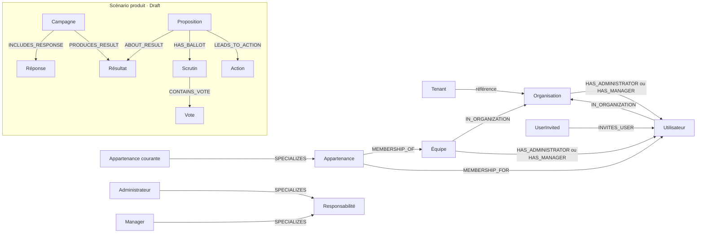

# TeamPulse — Ontologie métier

[Common Data Model](cdm.md) · [Graphe de connaissances](knowledge_graph.md)

## Sémantique et niveaux de preuve

Les identifiants `entity:*` du CDM sont également les identifiants de classes métier. `domain:*` désigne une capacité cohérente, `concept:*` un terme du vocabulaire et `rule:*` une règle. Ils restent stables lorsque leur implémentation change. Une classe ou relation confirmée ici est une connaissance sur le modèle. Une obligation annoncée par un document Draft est confirmée **comme intention documentée**. Son exécution exige d'autres preuves.

| Statut | Utilisation |
| --- | --- |
| **CONFIRMED** | Déclaration, comportement de code, contrainte ou énoncé documentaire directement attesté dans son périmètre. |
| **INFERRED** | Déduction à partir de plusieurs indices, avec hypothèses et portée explicites. |
| **AMBIGUOUS** | Plusieurs sens ou garanties demeurent plausibles. |
| **CONFLICTING** | Sources portant des assertions incompatibles pour un même périmètre. |
| **UNKNOWN** | Sources insuffisantes pour établir la connaissance ou sa mise en œuvre. |

## Domaines

| ID | Nom | Périmètre et preuve |
| --- | --- | --- |
| <a id="domain-organization"></a>`domain:organization` | Organisation | Racine tenant, cycle et responsables d'organisation. **INFERRED** pour le découpage. [Organization.java:13](../../tp-organization/src/main/java/io/teampulse/organization/domain/organization/model/Organization.java#L13) · [OrganizationLifecycle.java](../../tp-organization/src/main/java/io/teampulse/organization/api/lifecycle/OrganizationLifecycle.java) |
| <a id="domain-identity"></a>`domain:identity` | Identité | Compte utilisateur d'organisation, provisioning et disponibilité. **INFERRED** pour le découpage. [UserLifecycle.java](../../tp-identity/src/main/java/io/teampulse/identity/api/lifecycle/UserLifecycle.java) · [UserDirectory.java](../../tp-identity/src/main/java/io/teampulse/identity/api/user/UserDirectory.java) |
| <a id="domain-team"></a>`domain:team` | Équipe | Cycle d'équipe, responsables et participation temporelle des utilisateurs. **INFERRED** pour le découpage. [TeamLifecycleUseCase.java](../../tp-team/src/main/java/io/teampulse/team/application/port/in/team/TeamLifecycleUseCase.java) · [TeamMembershipUseCase.java](../../tp-team/src/main/java/io/teampulse/team/application/port/in/teammember/TeamMembershipUseCase.java) |
| <a id="domain-administration"></a>`domain:administration` | Administration de plateforme | Provisionnement d'utilisateur d'une organisation existante et garde de responsabilités. **INFERRED** pour le découpage. [UserLifecycleAdministrationUseCase.java](../../tp-administration/src/main/java/io/teampulse/administration/application/port/in/identity/UserLifecycleAdministrationUseCase.java) · [ADR-W001-T05-api-metiers-et-administration-plateforme.md:60](../../docs/adr/W001/ADR-W001-T05-api-metiers-et-administration-plateforme.md#L60) |

## Vocabulaire

Les quatre premières entrées pointent vers la définition structurée dans le CDM. Les termes « courant », « actif » et « disponible » ont des extensions distinctes selon leur contexte.

| ID | Terme et alias | Domaine / contexte | Définition et concepts associés | Preuve |
| --- | --- | --- | --- | --- |
| `entity:organization` | Organisation | Organisation | Racine opérationnelle de partition. Voir [organisation](cdm.md#entity-organization) et `concept:tenant`. | **CONFIRMED** · [Organization.java:13](../../tp-organization/src/main/java/io/teampulse/organization/domain/organization/model/Organization.java#L13) |
| `entity:user` | Utilisateur d'organisation, utilisateur métier, `User` | Identité | Identité rattachée à une référence d'organisation. Voir [utilisateur](cdm.md#entity-user), `concept:user-availability` et `concept:responsibility`. | **CONFIRMED** · [User.java:13](../../tp-identity/src/main/java/io/teampulse/identity/domain/user/model/User.java#L13) |
| `entity:team` | Équipe, `Team` | Équipe | Unité du tenant, à responsabilités propres. Voir [équipe](cdm.md#entity-team) et `entity:team-membership`. | **CONFIRMED** · [Team.java:11](../../tp-team/src/main/java/io/teampulse/team/domain/team/model/Team.java#L11) |
| `entity:team-membership` | Appartenance, adhésion, `TeamMember` | Équipe | Occurrence historique équipe-utilisateur. Le membre est l'utilisateur vu au travers de cette relation. Voir [appartenance](cdm.md#entity-team-membership). | **CONFIRMED** · [TeamMember.java:12](../../tp-team/src/main/java/io/teampulse/team/domain/team/model/TeamMember.java#L12) · [SCENARIO-METIER-TEAMPULSE.md:142](../../docs/besoins/SCENARIO-METIER-TEAMPULSE.md#L142) |
| <a id="concept-tenant"></a>`concept:tenant` | Tenant, périmètre d'organisation | Transverse | Partition d'exécution identifiée par une référence `ORG`. Une organisation persistée peut porter cette référence. Le contexte local possède sa propre référence en mémoire. | **CONFIRMED** · [TenantContext.java:12](../../tp-common/src/main/java/io/teampulse/common/context/TenantContext.java#L12) · [LocalTenantContextProvider.java:29](../../tp-app/src/main/java/io/teampulse/context/LocalTenantContextProvider.java#L29) |
| <a id="concept-functional-reference"></a>`concept:functional-reference` | Référence fonctionnelle, clé métier | Transverse | Identifiant canonique d'organisation, d'utilisateur ou d'équipe, avec famille `ORG`, `USR`, `TEM`. | **CONFIRMED** · [ReferenceFormat.java:33](../../tp-common/src/main/java/io/teampulse/common/reference/ReferenceFormat.java#L33) · [ADR-TECH-006-functional-references-over-persistence-identifiers.md](../../docs/adr/technical/ADR-TECH-006-functional-references-over-persistence-identifiers.md) |
| <a id="concept-actor"></a>`concept:actor` | Acteur d'audit, `ActorContext` | Transverse | Référence de l'initiateur utilisée pour tracer une écriture. L'implémentation par défaut représente le système. | **CONFIRMED** · [ActorContext.java:11](../../tp-common/src/main/java/io/teampulse/common/context/ActorContext.java#L11) · [ActorContextConfiguration.java:15](../../tp-app/src/main/java/io/teampulse/config/ActorContextConfiguration.java#L15) · [JpaAuditingConfiguration.java:19](../../tp-app/src/main/java/io/teampulse/config/JpaAuditingConfiguration.java#L19) |
| <a id="concept-lifecycle-state"></a>`concept:lifecycle-state` | État de cycle, statut | Transverse | Classe de valeurs conceptuelle. Chaque entité possède son propre ensemble fermé et son graphe de transitions. `ACTIVE` s'interprète dans le contexte de l'entité. | **INFERRED** pour la classe sémantique · [OrganizationStatus.java:15](../../tp-organization/src/main/java/io/teampulse/organization/domain/organization/model/OrganizationStatus.java#L15) · [UserStatus.java:16](../../tp-identity/src/main/java/io/teampulse/identity/domain/user/model/UserStatus.java#L16) · [TeamStatus.java:14](../../tp-team/src/main/java/io/teampulse/team/domain/team/model/TeamStatus.java#L14) · [TeamMemberStatus.java:15](../../tp-team/src/main/java/io/teampulse/team/domain/team/model/TeamMemberStatus.java#L15) |
| <a id="concept-user-availability"></a>`concept:user-availability` | Disponibilité utilisateur, `UserAvailability` | Identité | Verdict de consultation par couple organisation-utilisateur, utile aux décisions d'éligibilité. | **CONFIRMED** · [UserDirectoryService.java:44](../../tp-identity/src/main/java/io/teampulse/identity/application/service/user/UserDirectoryService.java#L44) |
| <a id="concept-organization-availability"></a>`concept:organization-availability` | Disponibilité organisation, `OrganizationAvailability` | Organisation | Verdict d'existence et d'état opérationnel. Une organisation existante peut demeurer indisponible. | **CONFIRMED** · [OrganizationDirectoryService.java:81](../../tp-organization/src/main/java/io/teampulse/organization/application/service/organization/OrganizationDirectoryService.java#L81) |
| <a id="concept-responsibility"></a>`concept:responsibility` | Responsabilité métier | Organisation, équipe | Position d'administrateur ou de manager dans un périmètre. Elle correspond actuellement à une référence dans son agrégat. Les vues de responsabilité lisent les affectations et l'état du périmètre. | **CONFIRMED** · [OrganizationResponsibilities.java:13](../../tp-organization/src/main/java/io/teampulse/organization/api/organization/OrganizationResponsibilities.java#L13) · [TeamResponsibility.java:6](../../tp-team/src/main/java/io/teampulse/team/api/TeamResponsibility.java#L6) |
| <a id="concept-administrator"></a>`concept:administrator` | Administrateur, `admin` | Organisation, équipe | Responsable du contenant dans le scénario. Le titulaire est désigné par une référence utilisateur dans le modèle. | **CONFIRMED** · [SCENARIO-METIER-TEAMPULSE.md:43](../../docs/besoins/SCENARIO-METIER-TEAMPULSE.md#L43) · [Organization.java:22](../../tp-organization/src/main/java/io/teampulse/organization/domain/organization/model/Organization.java#L22) · [Team.java:22](../../tp-team/src/main/java/io/teampulse/team/domain/team/model/Team.java#L22) |
| <a id="concept-manager"></a>`concept:manager` | Manager | Organisation, équipe | Responsable de l'exploitation du contenu dans le scénario. Le titulaire peut cumuler les responsabilités d'administrateur et de manager. | **CONFIRMED** · [SCENARIO-METIER-TEAMPULSE.md:43](../../docs/besoins/SCENARIO-METIER-TEAMPULSE.md#L43) · [OrganizationTest.java:282](../../tp-organization/src/test/java/io/teampulse/organization/domain/organization/model/OrganizationTest.java#L282) · [TeamLifecycleServiceIT.java:105](../../tp-team/src/test/java/io/teampulse/team/application/service/team/TeamLifecycleServiceIT.java#L105) |
| <a id="concept-current-membership"></a>`concept:current-membership` | Appartenance courante | Équipe | Appartenance dont l'état est `INVITED`, `ACTIVE` ou `SUSPENDED`. Elle est adressable par équipe et utilisateur dans le tenant. | **CONFIRMED** · [V0.1.1__create_team_members.sql:46](../../tp-team/src/main/resources/db/migration/team/V0.1.1__create_team_members.sql#L46) · [TeamMembershipService.java:126](../../tp-team/src/main/java/io/teampulse/team/application/service/teammember/TeamMembershipService.java#L126) |
| <a id="concept-membership-period"></a>`concept:membership-period` | Période d'appartenance | Équipe | Intervalle décrit par `startedAt` / `endedAt`. Une invitation retirée avant activation conserve une fin sans début. | **CONFIRMED** · [TeamMember.java:110](../../tp-team/src/main/java/io/teampulse/team/domain/team/model/TeamMember.java#L110) |
| <a id="concept-user-invitation"></a>`concept:user-invitation` | Invitation d'utilisateur | Identité | Création d'un utilisateur en `INVITED` avec publication du fait `event:user-invited`. | **CONFIRMED** · [UserLifecycleService.java:57](../../tp-identity/src/main/java/io/teampulse/identity/application/service/user/UserLifecycleService.java#L57) |
| <a id="concept-team-invitation"></a>`concept:team-invitation` | Invitation dans une équipe | Équipe | Création d'une appartenance `INVITED` pour un utilisateur déjà connu du tenant, éligible s'il est `AVAILABLE` ou `PENDING`. | **CONFIRMED** · [TeamMembershipService.java:49](../../tp-team/src/main/java/io/teampulse/team/application/service/teammember/TeamMembershipService.java#L49) · [TeamMemberUserAvailabilityValidator.java:27](../../tp-team/src/main/java/io/teampulse/team/application/service/teammember/TeamMemberUserAvailabilityValidator.java#L27) |
| <a id="concept-initial-user"></a>`concept:initial-user` | Utilisateur initial, premier utilisateur | Administration | Nom du parcours de création ou d'invitation dans une organisation existante. La notion « premier » peut décrire l'ordre attendu ou une unicité métier. Le service vérifie l'existence de l'organisation et applique les contraintes ordinaires d'identité. | **AMBIGUOUS** quant à l'unicité « premier » · [ADR-W001-T05-api-metiers-et-administration-plateforme.md:66](../../docs/adr/W001/ADR-W001-T05-api-metiers-et-administration-plateforme.md#L66) · [UserLifecycleAdministrationService.java:68](../../tp-administration/src/main/java/io/teampulse/administration/application/service/identity/UserLifecycleAdministrationService.java#L68) |
| <a id="concept-blocking-responsibility"></a>`concept:blocking-responsibility` | Responsabilité bloquante, `active responsibility` dans les erreurs | Administration | Affectation à une organisation non archivée ou à une équipe active/suspendue, dans le tenant demandé. Empêche la suspension ou désactivation via la plateforme. | **CONFIRMED** · [UserLifecycleAdministrationService.java:127](../../tp-administration/src/main/java/io/teampulse/administration/application/service/identity/UserLifecycleAdministrationService.java#L127) |
| <a id="concept-platform-administrator"></a>`concept:platform-administrator` | Administrateur plateforme | Vision produit | Rôle global distinct d'un compte tenant dans le scénario. La classe d'identité et sa relation au contexte d'exécution restent **UNKNOWN**. | **CONFIRMED** comme intention Draft · [SCENARIO-METIER-TEAMPULSE.md:27](../../docs/besoins/SCENARIO-METIER-TEAMPULSE.md#L27) |
| <a id="concept-organization-auditor"></a>`concept:organization-auditor` | Auditeur d'organisation | Vision produit | Rôle envisagé de lecture des traces administratives et de sécurité. | **CONFIRMED** comme intention Draft · [SCENARIO-METIER-TEAMPULSE.md:61](../../docs/besoins/SCENARIO-METIER-TEAMPULSE.md#L61) |
| <a id="concept-campaign"></a>`concept:campaign` | Campagne, pulse hebdomadaire | Vision produit | Collecte périodique de signaux auprès d'une équipe. | **CONFIRMED** comme intention Draft · [SCENARIO-METIER-TEAMPULSE.md:95](../../docs/besoins/SCENARIO-METIER-TEAMPULSE.md#L95) |
| <a id="concept-response"></a>`concept:response` | Réponse, contribution | Vision produit | Signal individuel pour une campagne. Le scénario cite l'humeur, la charge, les blocages, les risques et un commentaire éventuel. | **CONFIRMED** comme intention Draft · [SCENARIO-METIER-TEAMPULSE.md:95](../../docs/besoins/SCENARIO-METIER-TEAMPULSE.md#L95) |
| <a id="concept-result"></a>`concept:result` | Résultat agrégé, résultat publié | Vision produit | Restitution collective d'une campagne sous conditions de confidentialité. | **CONFIRMED** comme intention Draft · [SCENARIO-METIER-TEAMPULSE.md:107](../../docs/besoins/SCENARIO-METIER-TEAMPULSE.md#L107) |
| <a id="concept-proposal"></a>`concept:proposal` | Proposition d'action | Vision produit | Proposition du manager d'équipe reliée à un résultat ou une alerte. | **CONFIRMED** comme intention Draft · [SCENARIO-METIER-TEAMPULSE.md:123](../../docs/besoins/SCENARIO-METIER-TEAMPULSE.md#L123) |
| <a id="concept-ballot"></a>`concept:ballot` | Scrutin | Vision produit | Dispositif de décision sur une proposition par un ensemble de membres éligibles. | **CONFIRMED** comme intention Draft · [SCENARIO-METIER-TEAMPULSE.md:161](../../docs/besoins/SCENARIO-METIER-TEAMPULSE.md#L161) |
| <a id="concept-vote"></a>`concept:vote` | Vote, bulletin | Vision produit | Expression individuelle secrète dans un scrutin. | **CONFIRMED** comme intention Draft · [SCENARIO-METIER-TEAMPULSE.md:130](../../docs/besoins/SCENARIO-METIER-TEAMPULSE.md#L130) |
| <a id="concept-action"></a>`concept:action` | Action d'amélioration | Vision produit | Travail issu d'une proposition acceptée, suivi jusqu'à son évaluation. | **CONFIRMED** comme intention Draft · [SCENARIO-METIER-TEAMPULSE.md:134](../../docs/besoins/SCENARIO-METIER-TEAMPULSE.md#L134) |

<a id="event-user-invited"></a>

**`event:user-invited` · `UserInvited`.** Fait produit par l'invitation d'identité. Son payload porte les références d'organisation et d'utilisateur. La publication passe par l'adaptateur in-process Spring après le retour de l'écriture, dans la méthode transactionnelle. **CONFIRMED** pour le point de publication. Le checkout ne matérialise aucun consommateur métier de ce fait. Sa livraison effective et sa durabilité ne sont pas démontrées. [UserInvited.java:8](../../tp-identity/src/main/java/io/teampulse/identity/events/UserInvited.java#L8) · [UserLifecycleService.java:69](../../tp-identity/src/main/java/io/teampulse/identity/application/service/user/UserLifecycleService.java#L69) · [IdentityEventPublisherAdapter.java:16](../../tp-identity/src/main/java/io/teampulse/identity/infrastructure/messaging/IdentityEventPublisherAdapter.java#L16) · [ADR-W001-T05-api-metiers-et-administration-plateforme.md:109](../../docs/adr/W001/ADR-W001-T05-api-metiers-et-administration-plateforme.md#L110)

## Taxonomie et composition

- **Responsabilités.** `concept:administrator` et `concept:manager` spécialisent `concept:responsibility`. Chaque responsabilité s'interprète dans un périmètre organisation ou équipe. Les deux spécialisations peuvent partager un titulaire. Le recouvrement des titulaires ne crée aucune hiérarchie entre capacités.
- **Appartenances.** `concept:current-membership` est la sous-classe conditionnelle de `entity:team-membership` définie par son état. Les épisodes retirés en sont exclus. La période est décrite par les valeurs temporelles de l'appartenance.
- **Composition métier.** Les appartenances rattachent l'équipe à ses utilisateurs sur des épisodes. L'équipe relève d'une organisation. La composition n'implique aucune suppression en cascade démontrée. L'archivage d'une équipe laisse les appartenances existantes en base.
- **Valeurs.** Les quatre types d'états relèvent de `concept:lifecycle-state`. Les disponibilités sont des classifications issues des annuaires. Le résultat `NOT_FOUND` exprime une absence dans le périmètre de la lecture. Une défaillance d'annuaire donne une exception de contrat.
- **Vision.** Les rôles de plateforme et d'auditeur, la campagne et ses contributions, les résultats, propositions, scrutins, votes et actions sont issus du scénario Draft. Les relations de composition de ce scénario n'ont pas de cardinalités de stockage établies.

Sources **CONFIRMED** pour les comportements et **INFERRED** pour la taxonomie. [TeamMembershipService.java:112](../../tp-team/src/main/java/io/teampulse/team/application/service/teammember/TeamMembershipService.java#L112) · [TeamLifecycleService.java:73](../../tp-team/src/main/java/io/teampulse/team/application/service/team/TeamLifecycleService.java#L73) · [UserDirectoryService.java:36](../../tp-identity/src/main/java/io/teampulse/identity/application/service/user/UserDirectoryService.java#L36) · [V0.1.1__create_team_members.sql:24](../../tp-team/src/main/resources/db/migration/team/V0.1.1__create_team_members.sql#L24) · [SCENARIO-METIER-TEAMPULSE.md:165](../../docs/besoins/SCENARIO-METIER-TEAMPULSE.md#L165)

<a id="predicats-metier"></a>

## Prédicats métier

Les cardinalités sont lues du sujet vers l'objet. Les inverses définissent le parcours en lecture. Aucun de ces liens n'est déclaré transitif ou symétrique. Le sous-graphe et les données d'ingestion reprennent ces prédicats.

| Prédicat | Source → cible | Cardinalité / inverse | Sens, contraintes et niveau de preuve |
| --- | --- | --- | --- |
| `IN_ORGANIZATION` | Utilisateur ou Équipe → Organisation | 1 référence, inverse `HAS_USER` ou `HAS_TEAM` (0..*) | Fonctionnel sur la référence de tenant. L'existence du référent varie selon le parcours et aucune FK inter-module ne la garantit. **CONFIRMED** pour la référence, **INFERRED** pour le lien vers un objet effectivement résolu. [User.java:26](../../tp-identity/src/main/java/io/teampulse/identity/domain/user/model/User.java#L26) · [Team.java:20](../../tp-team/src/main/java/io/teampulse/team/domain/team/model/Team.java#L20) |
| `HAS_ADMINISTRATOR` | Organisation ou Équipe → Utilisateur | Organisation 0..1 selon l'état, équipe 1. Inverse `ADMINISTERS` (0..*) | Fonctionnel par périmètre. Même tenant vérifié à l'affectation ou au remplacement effectif. **CONFIRMED**. [Organization.java:344](../../tp-organization/src/main/java/io/teampulse/organization/domain/organization/model/Organization.java#L344) · [TeamResponsibleUsersValidator.java:26](../../tp-team/src/main/java/io/teampulse/team/application/service/team/TeamResponsibleUsersValidator.java#L26) |
| `HAS_MANAGER` | Organisation ou Équipe → Utilisateur | Organisation 0..1 selon l'état, équipe 1. Inverse `MANAGES_SCOPE` (0..*) | Fonctionnel par périmètre. Le même utilisateur peut occuper les deux responsabilités. **CONFIRMED**. [Organization.java:344](../../tp-organization/src/main/java/io/teampulse/organization/domain/organization/model/Organization.java#L344) · [TeamResponsibleUsersValidator.java:43](../../tp-team/src/main/java/io/teampulse/team/application/service/team/TeamResponsibleUsersValidator.java#L43) |
| `MEMBERSHIP_OF` | Appartenance → Équipe | 1, inverse `HAS_MEMBERSHIP` (0..*) | Fonctionnel. La FK composite impose l'association à l'équipe du même tenant. **CONFIRMED**. [V0.1.1__create_team_members.sql:24](../../tp-team/src/main/resources/db/migration/team/V0.1.1__create_team_members.sql#L24) |
| `MEMBERSHIP_FOR` | Appartenance → Utilisateur | 1 référence, inverse `HAS_MEMBERSHIP_HISTORY` (0..*) | Fonctionnel sur la référence. Unicité conditionnelle de la paire équipe-utilisateur pour le courant. La navigation historique peut restituer plusieurs épisodes. **CONFIRMED**. [TeamMembershipService.java:126](../../tp-team/src/main/java/io/teampulse/team/application/service/teammember/TeamMembershipService.java#L126) · [V0.1.1__create_team_members.sql:46](../../tp-team/src/main/resources/db/migration/team/V0.1.1__create_team_members.sql#L46) |
| `USES_ORGANIZATION_REFERENCE` | Tenant → Organisation | 1 référence, résolution 0..1, inverse aucun | Une référence tenant locale valide peut ne correspondre à aucune organisation persistée. **CONFIRMED**. [LocalTenantContextProvider.java:29](../../tp-app/src/main/java/io/teampulse/context/LocalTenantContextProvider.java#L29) · [ADR-W001-T05-api-metiers-et-administration-plateforme.md:95](../../docs/adr/W001/ADR-W001-T05-api-metiers-et-administration-plateforme.md#L95) |
| `SPECIALIZES` | Concept → concept ou classe métier | Selon taxonomie, inverse `GENERALIZES` | Inclusion sémantique. L'appartenance courante spécialise l'appartenance sous condition d'état. **INFERRED** pour cette formalisation. [TeamMemberStatus.java:15](../../tp-team/src/main/java/io/teampulse/team/domain/team/model/TeamMemberStatus.java#L15) · [V0.1.1__create_team_members.sql:46](../../tp-team/src/main/resources/db/migration/team/V0.1.1__create_team_members.sql#L46) |
| `PROJECTS_AVAILABILITY` | Utilisateur ou Organisation → concept de disponibilité | Un résultat par consultation réussie, inverse aucun | Projection contextualisée de l'état. Le résultat n'est ni assigné ni persisté en tant qu'état. **CONFIRMED**. [UserDirectoryService.java:44](../../tp-identity/src/main/java/io/teampulse/identity/application/service/user/UserDirectoryService.java#L44) · [OrganizationDirectoryService.java:81](../../tp-organization/src/main/java/io/teampulse/organization/application/service/organization/OrganizationDirectoryService.java#L81) |
| `INVITES_USER` | Événement `UserInvited` → Utilisateur | 1 référence dans le payload, inverse `INVITED_BY_EVENT` | Fait de création d'une identité invitée. Aucun nombre minimal de livraisons n'est établi par l'implémentation actuelle. **CONFIRMED** pour la référence. [UserInvited.java:8](../../tp-identity/src/main/java/io/teampulse/identity/events/UserInvited.java#L8) · [UserLifecycleService.java:57](../../tp-identity/src/main/java/io/teampulse/identity/application/service/user/UserLifecycleService.java#L57) |
| `INCLUDES_RESPONSE`, `PRODUCES_RESULT` | Campagne → Réponse, Résultat | Réponses 0..*, résultat cardinalité **UNKNOWN**. Inverses `ANSWERS_CAMPAIGN`, `RESULT_OF` | Relations de la vision. `0..*` déduit de la participation facultative et de l'unicité par participant. **INFERRED** pour cette cardinalité. [SCENARIO-METIER-TEAMPULSE.md:95](../../docs/besoins/SCENARIO-METIER-TEAMPULSE.md#L95) · [SCENARIO-METIER-TEAMPULSE.md:107](../../docs/besoins/SCENARIO-METIER-TEAMPULSE.md#L107) |
| `ABOUT_RESULT`, `HAS_BALLOT`, `CONTAINS_VOTE`, `LEADS_TO_ACTION` | Proposition → Résultat ou Scrutin, Scrutin → Vote, Proposition → Action | Cardinalités structurelles **UNKNOWN**. Inverses `MOTIVATES_PROPOSAL`, `VOTES_ON_PROPOSAL`, `CAST_IN`, `FROM_PROPOSAL` | Proposition motivée par un résultat ou une alerte et transformée en action en cas d'acceptation. Un vote par membre et scrutin dans le scénario. **CONFIRMED** comme intention Draft. [SCENARIO-METIER-TEAMPULSE.md:123](../../docs/besoins/SCENARIO-METIER-TEAMPULSE.md#L123) · [SCENARIO-METIER-TEAMPULSE.md:165](../../docs/besoins/SCENARIO-METIER-TEAMPULSE.md#L165) |

<a id="regles"></a>

## Règles

Les états de départ et d'arrivée s'appliquent à une même occurrence. Les contrôles d'annuaire sont des préconditions ponctuelles. Les données déjà persistées peuvent évoluer indépendamment par les cycles de vie de leurs propriétaires.

| ID | Règle et portée | Preuve |
| --- | --- | --- |
| <a id="rule-reference-format"></a>`rule:reference-format` | Une référence respecte le format syntaxique commun et le préfixe de son type. La fabrique garantit l'unicité de ses émissions au sein d'une instance. | **CONFIRMED** · [ReferenceFormat.java:33](../../tp-common/src/main/java/io/teampulse/common/reference/ReferenceFormat.java#L33) · [MonotonicReferenceFactory.java:154](../../tp-common/src/main/java/io/teampulse/common/reference/MonotonicReferenceFactory.java#L154) |
| <a id="rule-tenant-scope"></a>`rule:tenant-scope` | Les commandes et requêtes tenantées Identity, Team et Administration se font avec le tenant résolu par le serveur. Les lectures/écritures d'utilisateur ou d'équipe incluent le tenant. Les opérations Organization de plateforme utilisent la référence de l'organisation cible. | **CONFIRMED** · [UserController.java:38](../../tp-identity/src/main/java/io/teampulse/identity/infrastructure/web/user/UserController.java#L38) · [TeamController.java:35](../../tp-team/src/main/java/io/teampulse/team/infrastructure/web/team/TeamController.java#L35) · [UserLifecycleAdministrationController.java:44](../../tp-administration/src/main/java/io/teampulse/administration/infrastructure/web/identity/UserLifecycleAdministrationController.java#L44) · [OrganizationController.java:45](../../tp-organization/src/main/java/io/teampulse/organization/infrastructure/web/organization/OrganizationController.java#L45) |
| <a id="rule-local-tenant"></a>`rule:local-tenant` | Le profil local résout paresseusement un tenant par processus. Il conserve la première résolution valide et peut réessayer après un échec. La résolution n'écrit aucune organisation en base. | **CONFIRMED** · [LocalTenantContextProvider.java:29](../../tp-app/src/main/java/io/teampulse/context/LocalTenantContextProvider.java#L29) · [LocalTenantContextProviderTest.java:146](../../tp-app/src/test/java/io/teampulse/context/LocalTenantContextProviderTest.java#L146) |
| <a id="rule-local-bootstrap"></a>`rule:local-bootstrap` | Parcours local standard adressé au tenant mémoire. Une organisation créée par l'API obtient une nouvelle référence propre. Les opérations exigeant l'existence/activité du tenant mémoire ne sont donc pas amorçables par ce seul parcours. Identity peut créer sous cette référence sans vérifier l'organisation. | **INFERRED** · [LocalTenantConfiguration.java:13](../../tp-app/src/main/java/io/teampulse/context/LocalTenantConfiguration.java#L13) · [OrganizationLifecycleService.java:42](../../tp-organization/src/main/java/io/teampulse/organization/application/service/organization/OrganizationLifecycleService.java#L42) · [UserLifecycleAdministrationService.java:78](../../tp-administration/src/main/java/io/teampulse/administration/application/service/identity/UserLifecycleAdministrationService.java#L78) · [UserLifecycleService.java:40](../../tp-identity/src/main/java/io/teampulse/identity/application/service/user/UserLifecycleService.java#L40) |
| <a id="rule-audit-concurrency"></a>`rule:audit-concurrency` | Les écritures gèrent identité technique, audit et version en persistance. L'audit lit un acteur distinct du tenant. Les updates concurrentes détectées se traduisent selon le vocabulaire du module. | **CONFIRMED** · [JpaAuditingConfiguration.java:19](../../tp-app/src/main/java/io/teampulse/config/JpaAuditingConfiguration.java#L19) · [JpaUserRepositoryAdapterIdentityJpaIT.java:309](../../tp-identity/src/test/java/io/teampulse/identity/infrastructure/persistence/repository/JpaUserRepositoryAdapterIdentityJpaIT.java#L309) · [JpaTeamMemberRepositoryAdapterIT.java:158](../../tp-team/src/test/java/io/teampulse/team/infrastructure/persistence/repository/JpaTeamMemberRepositoryAdapterIT.java#L158) |
| <a id="rule-validation-ownership"></a>`rule:validation-ownership` | Contrat structurel à l'entrée, invariants dans les agrégats, existences et éligibilités en application, contraintes locales en SQL. Les absences et refus métier sont distincts des défaillances d'annuaire. Les advices propriétaires et partagé traduisent vers `ApiError`. | **CONFIRMED** · [AGENTS.md:363](../../AGENTS.md#L363) · [UserDirectoryService.java:36](../../tp-identity/src/main/java/io/teampulse/identity/application/service/user/UserDirectoryService.java#L36) · [TeamHttpErrorAdvice.java](../../tp-team/src/main/java/io/teampulse/team/infrastructure/web/TeamHttpErrorAdvice.java) · [SharedHttpErrorAdvice.java](../../tp-web-support/src/main/java/io/teampulse/websupport/error/SharedHttpErrorAdvice.java) |
| <a id="rule-user-profile-data"></a>`rule:user-profile-data` | Les noms sont normalisés par `strip()`, non blancs et bornés à 100 caractères Java. L'email est normalisé par `strip()` et minuscules, syntaxiquement validé et borné à 254 caractères Java. | **CONFIRMED** · [User.java:153](../../tp-identity/src/main/java/io/teampulse/identity/domain/user/model/User.java#L153) · [User.java:176](../../tp-identity/src/main/java/io/teampulse/identity/domain/user/model/User.java#L176) |
| <a id="rule-user-email-unique"></a>`rule:user-email-unique` | `(organizationReference, email canonique)` identifie au plus un utilisateur. La création vérifie le doublon avant l'écriture. PostgreSQL applique l'unicité sans filtre de statut et l'adaptateur traduit la collision. | **CONFIRMED** · [UserLifecycleService.java:89](../../tp-identity/src/main/java/io/teampulse/identity/application/service/user/UserLifecycleService.java#L89) · [V0.1.0__create_users.sql:24](../../tp-identity/src/main/resources/db/migration/identity/V0.1.0__create_users.sql#L24) · [JpaUserRepositoryAdapter.java:93](../../tp-identity/src/main/java/io/teampulse/identity/infrastructure/persistence/repository/JpaUserRepositoryAdapter.java#L93) |
| <a id="rule-user-lifecycle"></a>`rule:user-lifecycle` | Création directe en `CREATING`, invitation en `INVITED`. Le domaine permet `INVITED → CREATING`, `CREATING/SUSPENDED → ACTIVE`, `ACTIVE → SUSPENDED`, et tout état non terminal → `DEACTIVATED`. L'activation n'est pas exposée dans T05. | **CONFIRMED** · [User.java:53](../../tp-identity/src/main/java/io/teampulse/identity/domain/user/model/User.java#L53) · [UserStatus.java:16](../../tp-identity/src/main/java/io/teampulse/identity/domain/user/model/UserStatus.java#L16) · [UserLifecycle.java](../../tp-identity/src/main/java/io/teampulse/identity/api/lifecycle/UserLifecycle.java) |
| <a id="rule-user-availability"></a>`rule:user-availability` | `ACTIVE → AVAILABLE`, `INVITED/CREATING → PENDING`, `SUSPENDED/DEACTIVATED → UNAVAILABLE`. Absence dans le tenant → `NOT_FOUND`. Défaillance de lookup → exception dédiée. | **CONFIRMED** · [UserDirectoryService.java:25](../../tp-identity/src/main/java/io/teampulse/identity/application/service/user/UserDirectoryService.java#L25) · [UserDirectoryService.java:44](../../tp-identity/src/main/java/io/teampulse/identity/application/service/user/UserDirectoryService.java#L44) |
| <a id="rule-user-invited"></a>`rule:user-invited` | Une invitation d'identité réussie produit `UserInvited` avec deux références après la persistance. Un doublon d'email échoue avant la publication. | **CONFIRMED** · [UserLifecycleService.java:69](../../tp-identity/src/main/java/io/teampulse/identity/application/service/user/UserLifecycleService.java#L69) · [UserLifecycleServiceTest.java:242](../../tp-identity/src/test/java/io/teampulse/identity/application/service/user/UserLifecycleServiceTest.java#L242) · [UserLifecycleServiceTest.java:271](../../tp-identity/src/test/java/io/teampulse/identity/application/service/user/UserLifecycleServiceTest.java#L271) |
| <a id="rule-org-data"></a>`rule:org-data` | Le nom normalisé par `strip()` est non blanc avec un maximum de 200 caractères Java. Le fuseau doit être reconnu par `ZoneId.of`. | **CONFIRMED** · [Organization.java:439](../../tp-organization/src/main/java/io/teampulse/organization/domain/organization/model/Organization.java#L439) · [Organization.java:471](../../tp-organization/src/main/java/io/teampulse/organization/domain/organization/model/Organization.java#L471) |
| <a id="rule-org-lifecycle"></a>`rule:org-lifecycle` | Création `CREATING` sans responsables. Transitions de domaine `CREATING/SUSPENDED → ACTIVE`, `ACTIVE → SUSPENDED`, et de tout état non terminal vers `ARCHIVED`, en conservant les responsables à l'archivage. Le contrat T05 expose création, suspension et archivage. | **CONFIRMED** · [Organization.java:78](../../tp-organization/src/main/java/io/teampulse/organization/domain/organization/model/Organization.java#L78) · [OrganizationStatus.java:15](../../tp-organization/src/main/java/io/teampulse/organization/domain/organization/model/OrganizationStatus.java#L15) · [OrganizationLifecycle.java](../../tp-organization/src/main/java/io/teampulse/organization/api/lifecycle/OrganizationLifecycle.java) |
| <a id="rule-org-responsibility-shape"></a>`rule:org-responsibility-shape` | `ACTIVE` requiert deux références, `SUSPENDED` requiert l'administrateur, `CREATING/ARCHIVED` tolèrent les références absentes. Les responsables peuvent partager un titulaire. Le domaine vérifie les valeurs lors de la restauration et des transitions. | **CONFIRMED** · [Organization.java:344](../../tp-organization/src/main/java/io/teampulse/organization/domain/organization/model/Organization.java#L344) · [V0.1.0__create_organizations.sql:28](../../tp-organization/src/main/resources/db/migration/organization/V0.1.0__create_organizations.sql#L28) · [OrganizationTest.java:282](../../tp-organization/src/test/java/io/teampulse/organization/domain/organization/model/OrganizationTest.java#L282) |
| <a id="rule-org-availability"></a>`rule:org-availability` | Seul `ACTIVE` est `AVAILABLE`. Les autres états persistés donnent `UNAVAILABLE`, l'absence `NOT_FOUND`. Le contrat de responsabilités peut retourner une vue pour tout état persisté, avec références facultatives. | **CONFIRMED** · [OrganizationDirectoryService.java:49](../../tp-organization/src/main/java/io/teampulse/organization/application/service/organization/OrganizationDirectoryService.java#L49) · [OrganizationDirectoryService.java:81](../../tp-organization/src/main/java/io/teampulse/organization/application/service/organization/OrganizationDirectoryService.java#L81) |
| <a id="rule-org-assign"></a>`rule:org-assign` | Affecter un administrateur en `CREATING`. Affecter un manager en `CREATING` ou en `SUSPENDED` si absent. En `CREATING`, une nouvelle référence peut remplacer un candidat. Dans T05, le candidat doit être `AVAILABLE` dans le tenant, y compris avant le cas de réaffectation identique autorisée. | **CONFIRMED** · [Organization.java:134](../../tp-organization/src/main/java/io/teampulse/organization/domain/organization/model/Organization.java#L134) · [Organization.java:161](../../tp-organization/src/main/java/io/teampulse/organization/domain/organization/model/Organization.java#L161) · [OrganizationResponsibleUsersService.java:36](../../tp-organization/src/main/java/io/teampulse/organization/application/service/organization/OrganizationResponsibleUsersService.java#L36) · [OrganizationResponsibleUsersValidator.java:195](../../tp-organization/src/main/java/io/teampulse/organization/application/service/organization/OrganizationResponsibleUsersValidator.java#L195) |
| <a id="rule-org-activation-deferred"></a>`rule:org-activation-deferred` | Une affectation en `CREATING/SUSPENDED` qui compléterait les deux rôles avec des utilisateurs disponibles est refusée avant mutation (`LIFECYCLE_TRANSITION_DEFERRED`). L'affectation admise ne change jamais l'état. Les méthodes de domaine d'activation existent, avec entrée applicative reportée. | **CONFIRMED** · [OrganizationResponsibleUsersService.java:176](../../tp-organization/src/main/java/io/teampulse/organization/application/service/organization/OrganizationResponsibleUsersService.java#L176) · [OrganizationResponsibleUsersServiceIT.java:54](../../tp-organization/src/test/java/io/teampulse/organization/application/service/organization/OrganizationResponsibleUsersServiceIT.java#L54) |
| <a id="rule-org-replace"></a>`rule:org-replace` | Remplacement de l'administrateur ou du manager en `ACTIVE/SUSPENDED`. Le manager doit exister. Un nouveau candidat doit être `AVAILABLE`. Même référence dans un état admissible = aucune écriture. | **CONFIRMED** · [Organization.java:209](../../tp-organization/src/main/java/io/teampulse/organization/domain/organization/model/Organization.java#L209) · [Organization.java:237](../../tp-organization/src/main/java/io/teampulse/organization/domain/organization/model/Organization.java#L237) · [OrganizationResponsibleUsersService.java:132](../../tp-organization/src/main/java/io/teampulse/organization/application/service/organization/OrganizationResponsibleUsersService.java#L132) |
| <a id="rule-org-remove-manager"></a>`rule:org-remove-manager` | Retirer le manager depuis `ACTIVE/SUSPENDED`. Le retrait depuis `ACTIVE` suspend l'organisation. Si déjà suspendue sans manager, le domaine conserve cet état. | **CONFIRMED** · [Organization.java:264](../../tp-organization/src/main/java/io/teampulse/organization/domain/organization/model/Organization.java#L264) · [OrganizationResponsibleUsersServiceIT.java:155](../../tp-organization/src/test/java/io/teampulse/organization/application/service/organization/OrganizationResponsibleUsersServiceIT.java#L155) |
| <a id="rule-team-data"></a>`rule:team-data` | Le nom d'équipe normalisé est non blanc et a une longueur maximale de 200 caractères Java. Les deux références de responsables sont obligatoires. | **CONFIRMED** · [Team.java:138](../../tp-team/src/main/java/io/teampulse/team/domain/team/model/Team.java#L138) · [V0.1.0__create_teams.sql:8](../../tp-team/src/main/resources/db/migration/team/V0.1.0__create_teams.sql#L8) |
| <a id="rule-team-lifecycle"></a>`rule:team-lifecycle` | Créer en `ACTIVE` ou réactiver depuis `SUSPENDED` exige l'organisation et les deux responsables `AVAILABLE`. Suspendre depuis `ACTIVE`, ou archiver depuis `ACTIVE/SUSPENDED`, n'exige pas ces disponibilités et préserve les références. `ARCHIVED` est terminal. | **CONFIRMED** · [TeamLifecycleService.java:32](../../tp-team/src/main/java/io/teampulse/team/application/service/team/TeamLifecycleService.java#L32) · [TeamLifecycleService.java:59](../../tp-team/src/main/java/io/teampulse/team/application/service/team/TeamLifecycleService.java#L59) · [TeamStatus.java:14](../../tp-team/src/main/java/io/teampulse/team/domain/team/model/TeamStatus.java#L14) · [TeamLifecycleServiceIT.java:562](../../tp-team/src/test/java/io/teampulse/team/application/service/team/TeamLifecycleServiceIT.java#L562) |
| <a id="rule-team-replace"></a>`rule:team-replace` | Le remplacement effectif est possible si l'équipe est active ou suspendue et le candidat disponible dans le tenant. Une référence identique rend immédiatement l'équipe chargée sans écriture, avant le garde d'état du service. | **CONFIRMED** · [TeamResponsibleUsersService.java:28](../../tp-team/src/main/java/io/teampulse/team/application/service/team/TeamResponsibleUsersService.java#L28) · [Team.java:112](../../tp-team/src/main/java/io/teampulse/team/domain/team/model/Team.java#L112) |
| <a id="rule-member-open"></a>`rule:member-open` | Ajout, invitation, activation et réactivation exigent équipe active et organisation disponible. L'utilisateur doit être `AVAILABLE`, avec admission de `PENDING` pour l'invitation. Ajout ou invitation exige l'absence d'appartenance courante. | **CONFIRMED** · [TeamMembershipService.java:37](../../tp-team/src/main/java/io/teampulse/team/application/service/teammember/TeamMembershipService.java#L37) · [TeamMembershipService.java:84](../../tp-team/src/main/java/io/teampulse/team/application/service/teammember/TeamMembershipService.java#L84) · [TeamMemberUserAvailabilityValidator.java:40](../../tp-team/src/main/java/io/teampulse/team/application/service/teammember/TeamMemberUserAvailabilityValidator.java#L40) |
| <a id="rule-member-close"></a>`rule:member-close` | Suspension ou retrait cherche une appartenance courante dans une équipe active ou suspendue. Les transitions de l'appartenance restent applicables. Les annuaires d'éligibilité ne sont pas consultés sur ces chemins. | **CONFIRMED** · [TeamMembershipService.java:74](../../tp-team/src/main/java/io/teampulse/team/application/service/teammember/TeamMembershipService.java#L74) · [TeamMembershipService.java:96](../../tp-team/src/main/java/io/teampulse/team/application/service/teammember/TeamMembershipService.java#L96) · [TeamMembershipServiceIT.java:335](../../tp-team/src/test/java/io/teampulse/team/application/service/teammember/TeamMembershipServiceIT.java#L335) |
| <a id="rule-member-lifecycle"></a>`rule:member-lifecycle` | Invitation en `INVITED`, ajout en `ACTIVE`. Activation depuis `INVITED`, suspension depuis `ACTIVE`, réactivation depuis `SUSPENDED`. Retrait de tout état courant vers `REMOVED` terminal. | **CONFIRMED** · [TeamMember.java:47](../../tp-team/src/main/java/io/teampulse/team/domain/team/model/TeamMember.java#L47) · [TeamMember.java:74](../../tp-team/src/main/java/io/teampulse/team/domain/team/model/TeamMember.java#L74) · [TeamMemberStatus.java:15](../../tp-team/src/main/java/io/teampulse/team/domain/team/model/TeamMemberStatus.java#L15) |
| <a id="rule-member-dates"></a>`rule:member-dates` | `INVITED` a deux dates nulles. `ACTIVE/SUSPENDED` exige le début et une fin nulle. `REMOVED` exige la fin. Début et fin présents impliquent `endedAt ≥ startedAt`. La réactivation conserve le début initial. | **CONFIRMED** · [TeamMember.java:110](../../tp-team/src/main/java/io/teampulse/team/domain/team/model/TeamMember.java#L110) · [V0.1.1__create_team_members.sql:27](../../tp-team/src/main/resources/db/migration/team/V0.1.1__create_team_members.sql#L27) · [TeamMemberTest.java:68](../../tp-team/src/test/java/io/teampulse/team/domain/team/model/TeamMemberTest.java#L68) |
| <a id="rule-member-unique"></a>`rule:member-unique` | `(organizationReference, teamId, userReference)` identifie au plus une appartenance courante. Après retrait, l'historique persiste et un nouvel épisode est possible. L'index partiel arbitre les collisions concurrentes. | **CONFIRMED** · [TeamMembershipService.java:132](../../tp-team/src/main/java/io/teampulse/team/application/service/teammember/TeamMembershipService.java#L132) · [V0.1.1__create_team_members.sql:46](../../tp-team/src/main/resources/db/migration/team/V0.1.1__create_team_members.sql#L46) · [JpaTeamMemberRepositoryAdapterIT.java:115](../../tp-team/src/test/java/io/teampulse/team/infrastructure/persistence/repository/JpaTeamMemberRepositoryAdapterIT.java#L115) |
| <a id="rule-member-tenant-fk"></a>`rule:member-tenant-fk` | Pour chaque appartenance, `(team_id, organization_reference)` doit résoudre une équipe du même tenant en base. Le rattachement utilisateur passe par sa référence et les contrôles applicatifs. | **CONFIRMED** · [V0.1.1__create_team_members.sql:24](../../tp-team/src/main/resources/db/migration/team/V0.1.1__create_team_members.sql#L24) · [JpaTeamMemberRepositoryAdapterIT.java:128](../../tp-team/src/test/java/io/teampulse/team/infrastructure/persistence/repository/JpaTeamMemberRepositoryAdapterIT.java#L128) |
| <a id="rule-platform-provision"></a>`rule:platform-provision` | La plateforme vérifie l'existence de l'organisation du tenant et délègue à Identity la création/invitation. L'organisation peut être `CREATING`. Un échec de l'utilisateur laisse l'organisation préexistante en place. Le résultat contient les deux références. | **CONFIRMED** · [UserLifecycleAdministrationService.java:68](../../tp-administration/src/main/java/io/teampulse/administration/application/service/identity/UserLifecycleAdministrationService.java#L68) · [UserLifecycleAdministrationServiceIT.java:102](../../tp-administration/src/test/java/io/teampulse/administration/application/service/identity/UserLifecycleAdministrationServiceIT.java#L102) |
| <a id="rule-platform-guard"></a>`rule:platform-guard` | Avant suspension ou désactivation, une responsabilité dans une organisation non archivée ou une équipe active/suspendue du tenant bloque l'opération. Une simple appartenance ou un périmètre archivé ne bloque pas. Les annuaires sont vérifiés dans la transaction d'orchestration. | **CONFIRMED** · [UserLifecycleAdministrationService.java:105](../../tp-administration/src/main/java/io/teampulse/administration/application/service/identity/UserLifecycleAdministrationService.java#L105) · [TeamResponsibilityDirectoryServiceIT.java:59](../../tp-team/src/test/java/io/teampulse/team/application/service/team/TeamResponsibilityDirectoryServiceIT.java#L59) · [UserLifecycleAdministrationServiceIT.java:223](../../tp-administration/src/test/java/io/teampulse/administration/application/service/identity/UserLifecycleAdministrationServiceIT.java#L223) |
| <a id="rule-product-actor-boundary"></a>`rule:product-actor-boundary` | Vision Draft. Le rôle administrateur plateforme et le compte tenant sont exclusifs. Les rôles d'organisation et d'équipe sont contextualisés et cumulables. | **CONFIRMED** comme intention · [SCENARIO-METIER-TEAMPULSE.md:27](../../docs/besoins/SCENARIO-METIER-TEAMPULSE.md#L27) · [SCENARIO-METIER-TEAMPULSE.md:43](../../docs/besoins/SCENARIO-METIER-TEAMPULSE.md#L43) |
| <a id="rule-product-response"></a>`rule:product-response` | Vision Draft. Un membre répond au plus une fois par équipe et campagne. La réponse peut évoluer jusqu'à clôture. Les résultats sont calculés et masqués sous le seuil de confidentialité. | **CONFIRMED** comme intention, valeur du seuil **UNKNOWN** · [SCENARIO-METIER-TEAMPULSE.md:95](../../docs/besoins/SCENARIO-METIER-TEAMPULSE.md#L95) · [SCENARIO-METIER-TEAMPULSE.md:119](../../docs/besoins/SCENARIO-METIER-TEAMPULSE.md#L119) |
| <a id="rule-product-vote"></a>`rule:product-vote` | Vision Draft. Au plus un vote secret par membre et scrutin, modifiable jusqu'à clôture. L'ensemble éligible est figé à l'ouverture. L'acceptation transforme la proposition en action suivie. | **CONFIRMED** comme intention · [SCENARIO-METIER-TEAMPULSE.md:123](../../docs/besoins/SCENARIO-METIER-TEAMPULSE.md#L123) · [SCENARIO-METIER-TEAMPULSE.md:161](../../docs/besoins/SCENARIO-METIER-TEAMPULSE.md#L161) |
| <a id="rule-product-removal"></a>`rule:product-removal` | Vision Draft. Le retrait préserve les contributions antérieures et prive l'ancien membre de l'accès à l'équipe. Le normal peut être différé, l'urgent est immédiat avec motif audité. La réintégration ouvre une nouvelle période. T05 implémente le retrait daté et permet une nouvelle appartenance si les préconditions d’ouverture sont satisfaites. | **CONFIRMED** comme intention et pour la fin de l'épisode, politique d'accès/runtime **UNKNOWN** · [SCENARIO-METIER-TEAMPULSE.md:142](../../docs/besoins/SCENARIO-METIER-TEAMPULSE.md#L142) · [TeamMembershipService.java:96](../../tp-team/src/main/java/io/teampulse/team/application/service/teammember/TeamMembershipService.java#L96) |

## Représentation formelle

Triplets de **schéma**. Les objets d'un prédicat de cardinalité représentent des classes. Ils ne décrivent aucune instance du projet.

| Sujet | Prédicat | Objet |
| --- | --- | --- |
| `entity:user` | `IN_ORGANIZATION` | `entity:organization` |
| `entity:team` | `IN_ORGANIZATION` | `entity:organization` |
| `entity:team` | `HAS_MANAGER` | `entity:user` |
| `entity:organization` | `HAS_ADMINISTRATOR` | `entity:user` |
| `entity:team-membership` | `MEMBERSHIP_OF` | `entity:team` |
| `entity:team-membership` | `MEMBERSHIP_FOR` | `entity:user` |
| `concept:current-membership` | `SPECIALIZES` | `entity:team-membership` |
| `event:user-invited` | `INVITES_USER` | `entity:user` |

Extrait Turtle des axiomes minimaux. L'IRI URN sert de namespace de documentation. Les contraintes contextuelles et temporelles du registre restent à évaluer par des règles explicites.

```turtle
@prefix tp: <urn:teampulse:knowledge:> .
@prefix owl: <http://www.w3.org/2002/07/owl#> .
@prefix rdfs: <http://www.w3.org/2000/01/rdf-schema#> .

tp:TeamMembership a owl:Class .
tp:Team a owl:Class .
tp:CurrentMembership a owl:Class ;
    rdfs:subClassOf tp:TeamMembership .

tp:membershipOf a owl:ObjectProperty, owl:FunctionalProperty ;
    rdfs:domain tp:TeamMembership ;
    rdfs:range tp:Team ;
    owl:inverseOf tp:hasMembership .
```

Ici `tp:TeamMembership`, `tp:Team` et `tp:CurrentMembership` correspondent aux IDs `entity:team-membership`, `entity:team` et `concept:current-membership`. La propriété fonctionnelle exprime « au plus une » équipe. La présence est exigée par `rule:member-tenant-fk`.


